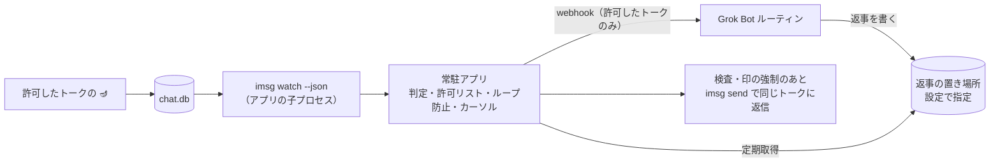

# genie-in-messages 仕様書（引き継ぎ用）

最終更新: 2026-11-03（JST。返事を2通に分ける。1通目はいつも 🧞‍♂️ だけ、2通目は返信文だけ。2通目の失敗と結果不明は1回だけ送り直す。4.3、4.4、4.9、5.1、決定 20。🪔 の判定は変えない）
ステータス: 要件確定・実機での事前確認済み・実装開始（2026-10-26 13:20 JST、オーナーが「ロックしないで使う、作り始めて」とOK）

旧仮名: `imsg-grok-bridge`

次にやること: 6章の2・3「中心処理とメニューバーアプリの実装」（エンジニア）

---

## 1. 目的

利用者自身のApple ID（iPhone / Mac など）から送った、呼び出しの合図（🪔）で始まるiMessageを、Mac上の常駐アプリが検知してGrok Botに渡し、Grok Botの返事を同じトークにiMessageで返信する。許可リストでオンにしたトークでは、自分も他のメンバーも、先頭が 🪔 のメッセージに反応する。オフのトークは監視対象外で、自分の 🪔 も無視する。最初の利用者はオーナー。

## 2. 決定済みの要件（オーナー決定）

| 項目 | 決定内容 |
|---|---|
| 対象トーク | 許可リスト制。メニューバーアプリでトークごとにオン・オフ。初期状態は全部オフ（4.7参照） |
| 発火条件 | 本文が合図 🪔 で始まるメッセージ（4.2参照。🧞 / 🧞‍♀️ / 🧞‍♂️ は使わない。旧案の🤖は廃止） |
| 送信者 | 許可リストでオンのトークにいる人は全員（自分も他のメンバーも、グループも1対1も）。送信者ごとの許可は無い。オフのトークは自分の送信も無視。自分宛てトークの `is_from_me = false` 側だけは今までどおり無視（4.10） |
| 動作 | メッセージをGrok Botに渡し、返事を同じトークにiMessageで返信 |
| 返事の経路 | B案。ボットは返事を決まった場所に書き、アプリが定期的に取りに行って、検査してから送る。置き場所は Notion のデータベース（5章） |
| 返信の印 | 返事を2通に分ける。1通目はいつも「🧞‍♂️」だけ。2通目は返信文だけ（4.4参照） |
| ボットの役割 | 何でも答える汎用アシスタント。担当は Grok Bot、受け口は webhook で起動するルーチン（4.5参照） |
| 実装形態 | Macに常駐するMacアプリ（メニューバーアプリ） |
| 開発ツール | Swift の Command Line Tools の導入OK（Xcodeは不要） |
| ソース管理 | GitHub `genie-in-messages` |
| 方針 | sudo を使わない。Keychain は署名用の証明書だけ使う（4.6参照）。それ以外の秘密は Keychain に入れない |
| 動かすMac | 同じApple IDで動かすMacは常に1台だけ（4.8参照） |

## 3. 実行環境（確認済み）

以下はオーナーの環境の例。ホスト名やバージョンをコードや設定の前提にしない。

- Mac mini、macOS 27.0.1、arm64、Homebrew 7.0.6
- 導入済みCLI: `imsg` 0.19.1（steipete/tap）、`peekaboo` 4.5.0（steipete/tap）
- Grok Botアプリには フルディスクアクセス / 画面収録 / アクセシビリティ を許可済み（自作アプリには別途許可が必要）
- FileVault は使っていない。再起動後の自動ログインは許可（自宅に置いている前提で、物理的に触れられるリスクは承知のうえ）
- `imsg` の主なコマンド: `chats`、`history --chat-id N --json`、`watch --json [--chat-id N] --since-rowid <n>`、`send`
- 注意: `/opt/homebrew/bin/imsg` は bash ラッパー。子プロセスとして起動するときは `/opt/homebrew/opt/imsg/libexec/imsg` を直接使う（許可の主体が bash にならないように）

## 4. アーキテクチャ



### 4.1 常駐アプリ
- メニューバーアプリ（`LSUIElement` の `.app`）。App Sandbox は使わない（imsg起動とフルディスクアクセスのため）
- ログイン時起動は `SMAppService.mainApp` で登録（LaunchAgent の plist 不要）
- メニュー表示: 状態、一時停止、トークの許可、最後のエラー、ログを開く。メニューバーの印は、白黒の template 画像（`isTemplate = true`）。黒と透明だけで描き、明るいバーと暗いバーの色は macOS に任せる。描くのはランプ本体と、注ぎ口より上の右寄りの雲だけ。紫は残さない。色は黒だけ。alpha は 0 か 255。高さ 18pt（@1x/@2x/@3x）いっぱいに出す。幅は承認した印の幅で、@1x が 21、@2x が 42、@3x が 63。引き伸ばさない。余白は alpha が 255 の画素で測り、承認した印は四辺とも 0。線は太くし、16px でもランプと分かる形にする。通常・一時停止・要対応は色を使わず形で描き分ける。通常は雲、一時停止は同じ高さの縦棒2本、要対応は「!」を雲の位置に描く。一時停止と要対応が重なったら要対応を出す。画像が無いときはログを出して、空ではない代わりの印を出す。Finder のアプリアイコンは、同じランプを切らずに、macOS の角丸の矩形（1024 なら内側 824、角半径 185。他のサイズは同じ比率）の内側へ縮小して収めたもの。背景は黒で、余白も黒で塗り、角丸の外は透明
- トークの許可はサブメニューにせず、検索できるウィンドウで切り替える（4.7）
- `imsg watch --json --since-rowid <cursor>` を子プロセスとして起動・監視し、落ちたら再起動する。標準出力と標準エラーは別々に読み切る。標準入力は開いたままにする。終わったときは、終了コードかシグナル、理由（アプリが止めた / プロセスが終了した / 起動できない）、秘匿した標準エラー、そのときの rowid、受け取った行数、行の最大長をログに1行残す。標準エラーは最後の空でない1行だけを残す。空白だけの行は飛ばして、その前の行を使う。単語は小文字にし、両端の記号と先頭・末尾の `.` を外してから、決まった安全な語（error、failed、permission、denied、locked、not、found、timeout、permitted など）だけを残し、それ以外は `[x]` にする。連続する `[x]` は1つにまとめる。120文字を超えるときは、切れた先頭の語を落として単語の境界で切る。本文・電話番号・宛先は出さない。シグナルで終わったときは終了コードの欄は `-` にする。一時停止や終了で止めたときも同じ1行を残すが、メニューの最後のエラーは変えない。勝手に落ちたときのメニューの最後のエラーは「imsg watch が終了したので再起動します」のまま。watch を止めるときは SIGTERM を送り、残っていれば SIGKILL を送る。一時停止ではその待ちで呼び出し側を止めない。アプリの終了では、子が止まるまで（残っていれば SIGKILL のあとまで）待ってから終える
- 送信: `imsg send --chat-id <id>` を子プロセスで実行する（AppleScriptでMessagesを操作する。8.2）
- 画面ロック: Mac mini は画面をロックしない運用にする。送信前にロック状態を確認し、ロック中なら送らずに保留して再試行する。保留中はメニューバーに警告を出す
  - ロック状態は「ロック / 解除 / 不明」の3つ。CoreGraphics の `CGSessionCopyCurrentDictionary` を直接呼び（dlsym は使わない）、通知 `com.apple.screenIsLocked` / `com.apple.screenIsUnlocked` も併用する。辞書にキーが無ければ解除、辞書が取れなければ不明
  - 不明のときは送信を試し、メニューに出す（判定が常に不明だと全送信が止まるため）
  - 安全網: 送信結果が `not_started`（-1712 と一緒に出る）なら保留して再試行する。-1712 だけで `not_started` が無い結果は結果不明として再送しない（2通目だけは 4.4 のとおり1回送り直す）
- 子プロセスの期限: send は 150 秒（`send_timeout_seconds`）、chats は 30 秒（`chats_timeout_seconds`）。期限を過ぎたら SIGTERM を送り、それでも止まらなければ SIGKILL で終わらせる。期限を超えた送信は結果不明として扱い、再送しない（2通目だけは 4.4 のとおり1回送り直す）
- 本文の渡し方: `imsg send --text` のまま（本文が `ps` に見える）。imsg 0.19.1 の send には本文を標準入力やファイルで渡す口が無い（`--file` は添付）。既知の制約として受け入れる
- SIPの無効化が必要な IMCore ブリッジは使わない
- スリープ対策: システム設定「エネルギー」で、ディスプレイオフ時もスリープしない／ネットワークで復帰／停電後に自動起動。補助として子で `caffeinate -i -s -w <pid>`（caffeinate を親にしない）

### 4.2 判定ロジック
判定の前に、本文をNFCに正規化する（8.4）。

次の4つをすべて満たすときだけ発火:
1. そのトークが許可リストでオンになっている（4.7）。オフのトークは監視対象外で、自分の 🪔 も無視する
2. 本文の先頭（先頭の空白、不可視文字、VS16〈U+FE0F〉を無視した後）が 🪔（U+1FA94）で始まる。直後の U+FE0F はあってもなくても受け付ける。不可視文字だけの接頭辞は空と同じ。不可視はゼロ幅や制御文字など画面に出ないものだけで、U+0601 のような目に見える書式文字は飛ばさない。この判定は変えない
3. 新規メッセージ（edited / unsent などのイベントではない）
4. 自分宛てトークの受信側でない
   - オンのトークでは、自分（`is_from_me = true`）も他のメンバー（`is_from_me = false`）も同じ。送信者ごとの許可は無い
   - グループと、相手がいる1対1では、相手の `is_from_me = false` を受け付ける
   - 自分宛てトークは、グループでなく、participant が1人で、その人が自分のハンドルと一致するとき。その `is_from_me = false` 側は無視する（8.3、4.10）
   - 自分のハンドルと一致しない participant がいる1対1は、相手の `is_from_me = false` を受け付ける
   - 自分のハンドルが不明、`participants` が無い、または空のときは、安全側で `is_from_me = false` を無視する。オンのトークの `is_from_me = true` は反応する

文中や文末の 🪔 には反応しない。タップバックやリアクション（`is_reaction`）、添付だけで本文が合図で始まらないメッセージにも反応しない。添付が付いていても本文の先頭が 🪔 なら反応する。他のメンバーが 🧞‍♂️ で始まる文を送っても反応しない（合図は 🪔 だけ）。

ログには本文、電話番号、ハンドル、宛先を出さない。

あとから合図付きに編集したメッセージには反応しない。

🧞、🧞‍♀️、🧞‍♂️ は呼び出しに使わない。iPhone から 🧞‍♂️ が届いたときの記録は 8.4 に残す。呼び出しとしての 🪔 を実機で受け取ったときのコードポイントは、まだ確かめていない（9章）。

旧案の🤖も合図として使わない。

### 4.3 重複・取りこぼし防止
- rowid カーソルを保存し、再起動時は `--since-rowid` で続きから読む
- カーソルは条件に合わないメッセージも含めた最大値でのみ更新（巻き戻さない、edited/unsent では動かさない）
- 重複はメッセージの guid を冪等キーにして止める
- 確実に送れていない失敗と、途中で落ちた送信（次の起動で `send_interrupted` として記録）は、本文なしで deadletter に残す。watch の行は、deadletter を書けたときだけ処理済みにし、書けなかった行はカーソルも既読 guid も進めない。返事の送信が途中で落ちたときは、deadletter を書けなくてもその `reply_id` を処理済みにし、同じ返事を二重に送らない。deadletter の書き込みは次の起動でやり直す
- 一時停止中や書き込みに失敗したあとは、同じ watch の続きでカーソルを進めない
- 2通に分けた返事（4.4）の途中経過は、state の `partial_replies`（`reply_id`、`chat_id`、`marker_guid`、`at`、`body_resends`）に残す。1通目の途中で落ちたら、今までどおり `send_interrupted` で処理済みにし、2通目は送らない。1通目と2通目のあいだで落ちたら、再起動後に読み直して2通目だけを送る。2通目の途中で落ちたら、結果不明と同じに扱う。送り直しがまだなら1回だけ送り直し、済んでいれば deadletter `body_send_interrupted` にする。どの場合も1通目は送り直さない。`part` や `partial_replies` が無い古い state も読める
- 1MB を超える watch 行は本文を捨てる。rowid が取れれば deadletter に残してカーソルを進め、取れなければ止める
- Messages の DB が入れ替わって、同じ ROWID の guid が変わったら、許可リスト・送り先の対応表・カーソルを捨てる（ROWID が別のトークを指すのを防ぐ）。送る前の予約、保留、`partial_replies` も捨てる。入れ替えの前に始めた送信の結果が入れ替えのあとに戻っても、部分の記録も保留も作らず、2通目も送らない
- 起動直後は、トーク一覧との最初の照合が終わるまで返事を取らず、送らない
- 許可したトークは、その一覧で guid を確かめられたときだけ送る。guid が違うとき、一覧が空のとき、そのトークが一覧に無いとき、一覧の取得に失敗したときは送らない。送らなかった理由はメニューの「照合」の行とログに短い日本語で出す。番号、メールアドレス、識別子は出さない。一覧の取得が失敗したら、すぐログに出す。メニューには、最初の失敗から60秒続いたときに出す。取得が成功したら、その表示は消える。解決していない解析の問題があれば、その回に許可したトークを確かめられたかどうかに応じた表示に戻る。一部の行だけ読めて、許可したトークを確かめられたときは「一覧の一部の行を読めませんでした。許可したトークは一覧で確かめられました」と出す。送っているとは書かない。定期処理は `GeniePoller.tick()` だけが行い、一覧の読み取りもそこだけが行う。この行は最後のエラーとは別で、ほかのエラーを上書きしないし、消さない。待っている返事は「待っています」、guid が違って捨てた返事は「捨てました」と書く。一覧に無いときは、設定の `chats_limit`（既定 100）を増やすと一覧に入ることがある、と案内する。照合の行が出ているあいだ、メニューバーのランプは要対応になる
- 一覧が空、一覧に無い、一覧を読めないときは、その返事を処理済みにせず、次の取得まで待つ。照合の表示が消えるのは、その返事が `route_ttl_seconds` を過ぎて捨てられたときと、一覧で許可したトークの guid を確かめられたとき。取得の失敗の表示は、取得が成功した時点で消える。解析の問題は、行がすべて読めて許可したトークを確かめられるまで残る。一部の行だけ読めなかったときは「返事を待っています」とは出さない。期限切れで消すのは、一時的な保留だけ。一覧の失敗ログは error で、解決するまで重ねない。guid が違うときは、その返事をその場で捨てて送らない。その表示は、あとから一覧の guid が許可と一致したときに消える。期限切れでは消さない。ほかの理由で一時的に上書きされても、guid が合うまでは不一致の表示に戻る
- 自分宛てトークでは1通ごとに `is_from_me=true` と `is_from_me=false` の2件が別の rowid・guid で記録される。自分宛てと判定したときと、判定できないときの `is_from_me=false` 側は無視する（4.2、4.10）。グループと、相手がいる1対1の `is_from_me=false` は受け付ける。`created_at` の一致では重複を判定しない（ずれることがあり、受信側の rowid が後になることもある。8.3）
- 比較・ハッシュの前に本文をNFCに正規化する（8.4）
- webhook 送信の再送は指数バックオフ＋回数上限。失敗分は `deadletter.jsonl` に残す（本文は残さない）
- 既知の制約: 停止中に起きた編集・取り消しは再起動後も再送されない。`imsg history` は既定50件なので補完時は `--limit` を広めに

### 4.4 ループ防止（自分の送信が対象のため必須）
- 返事は2通で送る。1通目は印だけ、2通目は返信文だけ（決定 20）
- 1通目は、いつも「🧞‍♂️」（U+1F9DE U+200D U+2642 U+FE0F の4つ。UTF-8 で13バイト）だけ。前後に空白も改行も付けない。設定では変えない（`marker` は廃止。4.9）
- 2通目の本文は、送信側のコードで次の順に作る（ボットへの指示に頼らない）
  1. NFC にする。先頭が合図なら外し、続く空白も外す（判定は4.2と同じ関数）
  2. 先頭の空白、改行（U+3000 を含む）、不可視文字、🧞‍♂️（末尾の U+FE0F が無い形も）を、無くなるまでくり返し外す。比較はコードポイント単位
  3. 残りが空なら、1通目も2通目も送らずに処理済みにする（ログ `reply_empty_body`）
  4. 残りが合図で始まるなら、どちらも送らずに処理済みにする（`reply_still_matches_signal`）。合図で始まらないことは、2通目の本文そのもので確かめる
- 1通目の imsg が空でない guid を返したときだけ、2通目を送る。1通目が結果不明（guid が無いときを含む）か失敗なら、2通目は送らない
- 1通目は送り直さない。届いていないと分かっているとき（-1712、または失敗がはっきりしていて deadletter を書けないとき）だけ保留して送り直す
- 1通目が届いたことを state（`partial_replies`）に保存してから、2通目を送る。保存できなければ2通目を保留し、保存できるまで送らない
- 2通目の前に、一時停止・停止、許可、トークの guid、画面ロックを確かめ直す。止まっていれば2通目だけを保留する。許可オフと guid の不一致なら、2通目を送らずに処理済みにする
- 2通目が失敗か結果不明（途中で落ちたときを含む）なら、2通目だけをちょうど1回送り直す。本文が2回届くことは許す。送り直しも失敗か結果不明なら deadletter（`body_send_failed`、`body_send_uncertain`、`body_send_interrupted`）にし、それ以上は送らない。deadletter を書けなくても送り直さず、処理済みにして、次の起動で書き直す
- 送り直した回数は state（`body_resends`）に残す。再起動しても数え直さない。-1712、画面ロック、一時停止・停止で2通目を保留したときは、送り直しの回数に数えない
- 同じトークでは、前の返事の2通が終わるか捨てられるまで、次の返事の1通目を送らない
- `imsg send` が返した guid（`{"id":..,"status":"sent","guid":..}`）を、1通ごとに記録する。watch に戻ってきた同じ guid のメッセージには反応しない
- 補助として、送信前に1通ごとに「文面ハッシュ（NFC正規化後）＋時刻」を記録し、watch に戻ってきたものと一致したら無視する。比べるのは受信の `created_at` と記録の時刻で、差が120秒以内なら一致。1通目のハッシュは毎回同じなので、窓のあいだに同じトークで誰かが 🧞‍♂️ だけを送ると、指紋で無視される。🧞‍♂️ は合図ではないので、反応しないことは変わらない。指紋を取り消すときは1件だけ消す
- 2通目が合図で始まらないことの確認と、guid 記録・指紋・自分宛てトークの `is_from_me=false` 側の無視を併用する。グループの他メンバーが 🧞‍♂️ を送っても合図には当たらない。同じ guid は1回だけ処理する
- 返事の ID は送信の前に予約し、2通（送り直しを含む）を送り終えるまで保つ。レート停止の解除と返事の取得が重なっても、二重には送らない
- 送信レート上限（例: 1分5件）は、返事1件を1回として数える。枠は1通目の前に確かめて予約する。2通目と送り直しは、レートの枠もレートの自動停止（`halted_chat_ids`）も見ず、枠も使わない。`StopSignal` と一時停止は必ず見る。送信の完了を待たずに、並行する取得や保留の再送が同じ枠を使えない。1通目を送れなかったとき（起動前の失敗、送信失敗）は予約を戻す。1通目の結果不明と、1通目が届いたあとは戻さない。超えたらそのトークへの返信を自動停止し、メニューバーに警告。停止の解除は停止フラグだけを外し、窓の中の回数は残す

### 4.5 ボットとの受け渡し・秘密情報・ログ
- 受け取るのは Grok Bot の、webhook で起動するルーチン。役割は何でも答える汎用アシスタント
- 本文はそのまま webhook に送ってよい。ただし送るのは許可リストでオンのトークのメッセージだけ
- アプリのログ（`deadletter.jsonl` を含む）には許可語以外を残さない。標準エラーに出た語は小文字にし、両端の記号（先頭と末尾の `.` を含む）を外してから照合する
- webhook に渡す前に、メッセージの guid とトークの chat_id の対応を state に保存する（既定 7 日、`route_ttl_seconds`）。返事の送り先はこの対応から決める（5.1）
- webhook の各試行と、保留中の返事の再送のたびに、外に出す直前に許可リストと一時停止を確かめ直す。保留の再送では、返事の `created_at` が `route_ttl_seconds` より古くないかを確かめる（対応を保存した時刻ではない。差は返事ができるまでの数秒から数分で、期限の既定 7 日に比べて小さい）。期限を過ぎた保留は送らず処理済みにする。オフにしたトークの保留は捨てる
- webhook の認証は Bearer。本文 JSON に `idempotency_key`（メッセージの guid）を入れる（`Idempotency-Key` ヘッダはボットに届かないため）
- webhook の `v` は 1 のまま。`sender_is_me`（bool）と `sender_name`（文字列）を足す。自分なら `self_sender_name`（空、空白だけ、不可視文字だけなら既定 `me`）。自分以外は、任意の `sender_names` を正規化したハンドルで引き、無ければ imsg が行に既に付けている連絡先名、それも無ければ空文字。連絡先名がメールまたは電話番号の形なら、`sender` が空でも空文字にする。`sender` と同じハンドルのときも空文字にする。ハンドル、電話番号、メールアドレスは payload に入れない。表示名の表が無くても反応は変わらない。空の `sender_name` も JSON に出す。`v` を 2 にしない理由: 足した欄だけで、既存の欄の意味は変えていない。`v == 1` だけを見る受け側は、今までどおり本文と guid と chat_id を使える。未知の欄を無視する受け側もそのまま動く。ハンドルを載せないので、payload に電話番号やメールは増えない。`sender_name` が空でも、今までの受け側は本文を使える
- 形の例（ハンドルは入らない）:

```json
{
  "v": 1,
  "event": "message",
  "idempotency_key": "<guid>",
  "guid": "<guid>",
  "chat_id": 42,
  "text": "🪔 ...",
  "created_at": "2026-10-27T00:00:00Z",
  "sender_is_me": false,
  "sender_name": "hana"
}
```
- 通信は `URLSession.shared` を使わず、キャッシュしないセッションを使う。空でない URL は https だけ
- webhook のシークレットは設定ディレクトリ（例: `~/.config/genie-in-messages/`、ディレクトリ700）の `secret`（600）。plist や引数・環境変数に入れない。送信のたびに読み直す（差し替えに再起動不要）
- Notion のトークンも同じ扱い。`notion-token`（600）に置き、使うたびに読み直す。メニューの「Notion トークンを設定」から入れ、画面には出さない。状態表示は「設定済み」「未設定」「権限が 600 ではありません」だけ。Keychain は使わない
- GET JSON の取得元を使うときのトークンは任意の `reply-secret`（600）

### 4.6 許可と署名
- フルディスクアクセスは `.app` に付与。子の imsg はその許可で読める見込み（要実機確認）
- オートメーション（Messages 操作）: Info.plist に `NSAppleEventsUsageDescription`。Hardened Runtime なら apple-events entitlement。初回送信時に許可ダイアログが1回出る。自作アプリから imsg を起動すると、Grok Bot アプリで許可済みでも改めて許可を求められる見込みなので、初回の設定手順に入れる
- 署名: 署名用の証明書だけ Keychain に入れ、安定した署名IDで許可を保つ。オーナーは Apple Developer Program 会員なので、Apple Development 証明書を使う。アドホック署名（`codesign -s -`）は再ビルドのたびに許可が外れるので使わない
- ビルド: `swift build` → スクリプトで `.app` を組み立て → Info.plist 配置 → codesign。ローカルビルドなので quarantine は付かない
- 配布（後の段階）: 他の人に配るときは Developer ID で署名し、公証（notarization）を通す。今は仕様に書くだけで、実装しない

### 4.7 許可リスト
- メニューバーアプリは `imsg chats --json` のトーク一覧を、検索欄のあるウィンドウに出す。サブメニューにはしない。オンのトークを上に、1対1をグループより上に並べ、名前と id のどちらでも絞る。トークごとにオン・オフを切り替える。一覧の件数より外でオンになっている id は「id:N（一覧外）」として先頭に出し、そこでオフに戻せる
- 初期状態は全部オフ。オンにしたトークだけが判定（4.2）とボットへの受け渡しの対象
- 許可していないトークのメッセージはボットに渡さない
- オンにしたトークにいる人は全員が合図の対象。送信者ごとの許可リストは無い
- トークの識別には `chat.ROWID`（`imsg chats` の `id`）を使う。表示名は変わることがあるので使わない

### 4.8 動かすMacは1台だけ
- 同じApple IDで動かすMacは常に1台だけにする。iCloud同期で同じメッセージが複数のMacの chat.db に届き、二重に返信してしまうため
- 導入手順と画面で「同じApple IDのほかのMacでは動かさない」と明記する
- 検討事項: ブリッジ側で guid を使って複数台の重複を止める方法（例: 処理済み guid を共有の場所に記録して先着1台だけが処理する）。1台運用の補助として設計で検討する

### 4.9 設定と利用者ごとの分離
- オーナー専用の値をコードに直接書かない。次はすべて設定から読む
  - webhook のURL、シークレット、返事を取りに行く場所、許可リスト
  - `config.json` の主な項目: `notion_data_source_id`、`route_ttl_seconds`（既定 604800）、`send_timeout_seconds`、`chats_timeout_seconds`、`reply_page_limit`（既定 100）、`self_sender_name`（既定 `me`）、`sender_names`（任意。既定は空）、`self_chat_ids`（任意。既定は空）
- `self_sender_name`、`sender_names`、`self_chat_ids` が無い古い `config.json` も読める。反応の対象は許可リストのオン・オフと 4.10 の判定で、表示名の表が無くても反応は変わらない。デコードでは落とさない
- `marker`（返信の印）は廃止した。古い `config.json` にあっても読み飛ばし、送信には使わない。印を既定に戻す警告も出さない。1通目はいつも 🧞‍♂️（4.4、決定 20）
- 別の人が使うときは、その人自身のMac、Apple ID、Grok Botで動かす。オーナーの Grok Bot にはつながない

### 4.10 自分宛てトークの判定と表示名
呼べるかどうかは、メニューのチャット許可（4.7）だけ。オンのトークにいる人は、自分も他のメンバーも、グループも1対1も、先頭が 🪔 なら呼べる。送信者ごとの許可は無い。オフのトークは監視対象外で、自分の 🪔 も無視する。

自分宛てトークは、グループでなく、空白でない participant がちょうど1人で、その人が自分のハンドルと一致するトーク。実機の imsg 0.19.1 の `imsg chats --json` では、次のとおりだった。

- 自分宛て: `is_group` は false。`participants` は1人で、それは自分のハンドル。`identifier` とも `last_addressed_handle` とも一致する
- 普通の1対1: `is_group` は false。`participants` は1人で `identifier` と一致するが、`last_addressed_handle` とは一致しない
- グループ: `is_group` は true。`participants` は複数で、自分は入らない

`participants` が空、という形では自分宛てを表さない。空とみなすと、自分宛ての1人が普通の1対1に見え、`is_from_me = false` の重複に二重反応する。

自分のハンドルは、watch の行の `destination_caller_id`（送った側に付く、自分の番号）があればそれを覚える。無いときは、起動時と、その後おおよそ30秒ごとに `imsg chats --json` を読む。各チャットの `last_addressed_handle` を、既存のハンドル正規化で自分のハンドル候補にする。グループでなく participant が1人で、その人がそのチャット自身の `last_addressed_handle` と一致するチャットは自分宛てである。他のチャットの `last_addressed_handle` も候補に含める。`sender` と `chat_identifier` が同じかどうかでは決めない。普通の1対1では、送った側も受け取った側も相手のハンドルになることがある。

グループは `is_group` が true、または `chat_guid` か `chat_identifier`（chats では `guid` か `identifier`）に `;+;` を含む。`SERVICE;-;TARGET` は1対1で、グループではない。グループでは `is_from_me = false` を受け付ける。

`participants` は、watch の行にあればそれを使う。行に無く、文字列の配列として読めないときは、直近に読めた `imsg chats` のその `chat_id` の `participants` を使う。

次の順で、`is_from_me = false` を無視するかどうかを決める。

1. `self_chat_ids` にその `chat_id` がある。自分宛てとして上書きする。グループに見えても、相手がいる1対1に見えても、`is_from_me = false` は無視する。このキーが無くても動く
2. グループ。`is_from_me = false` を受け付ける
3. `participants` が文字列の配列としてあり、空白でない人がいて、そのうち自分のハンドル候補と一致しない人がいる。普通の1対1として、相手の 🪔 を受け付ける。自分のハンドル候補が1つも無いときは、ここで受け付けない
4. それ以外は安全側。`is_from_me = false` を無視する。次を含む。自分のハンドルが不明。`participants` が無い、null、または文字列の配列として読めない。`participants` が空、または空白だけ（相手がいると確認できない。自分宛てとも断定しないが、重複側には反応しない）。participant が1人で、その人が自分のハンドルと一致する（自分宛て）。オンのトークの `is_from_me = true` は、このどれでも反応する

`imsg chats` の実行が失敗した回、行のパースに失敗した回は、前回読めた一覧と、それまでに覚えた自分のハンドルを残す。一度も読めておらず、watch の行からも自分のハンドルが無いときは、上の安全側になる。失敗のログは `chats_failed` または `chats_parse_failed` だけで、標準出力、標準エラー、ハンドル、本文は出さない。

`self_chat_ids` は `chat.ROWID` の配列。無い、または null なら空。壊れた形で設定全体が読めないときは、今までどおり `config_unreadable` とし、直前の設定を使い続ける。

表示名は任意で、反応の可否には使わない。連絡先を新しく読む権限は要らない。imsg が行に付けている `sender_name` だけを使う。

```json
{
  "self_sender_name": "me",
  "sender_names": {
    "+81 90 0000 0000": "hana",
    "hana@example.com": "hana-mail"
  },
  "self_chat_ids": [7]
}
```

例の番号とメールは架空（`example.com` は文書用。`090-0000-0000` のようなゼロの並びは実在の加入者番号として使わない）。`config.example.json` の `sender_names` は空にする。

- 自分（`is_from_me = true`）の `sender_name` は `self_sender_name`。空、空白だけ、不可視文字だけなら `me`
- 自分以外は、下の比較キーで `sender_names` を引く。当たればその表示名
- 表に無ければ、行の連絡先名。空、空白だけ、不可視文字だけなら空文字。連絡先名自体がメールまたは電話番号の形（下の比較キーが取れる）なら、`sender` が無くても空文字。`sender` と大文字小文字を無視して同じ、または同じ比較キーのときも空文字。番号やメールを payload に出さないため
- 表が無くても、連絡先名が無くても、反応は変わらない。ハンドルは payload にもログにも出さない
- 同じ比較キーが複数あるときは、ハンドル文字列の辞書順で先の表示名を使う。空の表示名と、比較できないハンドルは落とす
- `sender_names` が無い、または null なら空。それ以外の壊れた形で設定全体が読めないときは、今までどおり `config_unreadable` とし、直前の設定を使い続ける
- `self_sender_name` と `sender_names` が無い古い `config.json` も読める。自分の表示名は `me`、他のメンバーは連絡先名か空

比較キー（`sender_names` のキーと、watch の `sender` の両方に同じ規則を使う。許可の判定には使わない）:

1. 前後の空白を除く
2. ASCII の `@`（U+0040）を含むときはメール。全体を小文字にする（ローカル部も）。ドットや `+` 以降は残す。途中の空白は残るので、空白の無いアドレスとは一致しない。大文字と小文字だけを吸収する
3. `@` を含まないときは電話番号。全角数字（U+FF10–FF19）と全角の `＋`（U+FF0B）は半角にする。空白、ハイフン、括弧、ドット、その他の数字でも英字でもない文字は区切りとして除く。英字が残ったら電話番号とみなさず、一致しない
4. 先頭の `00` は国際プレフィックスとして外し、先頭に `+` があったものと同じ規則にする。その結果または最初から `+` のあとに `81` が続くときは、日本の国番号を外す。残りの先頭が `0` でなければ `0` を付ける。`+81 090...` のように `0` が既にあるときは付けない。結果は国内の数字の並び（例: `09000000000`）。`00` のあとが `81` でないときは 7
5. `+` も `00` も無く、`0` で始まる国内形式は、区切りを除いた数字のまま
6. `+` が無く `81` で始まる列は、12桁（`81` と国内10桁）、または 13桁で国番号の直後が `0` のときだけ、4 と同じ国内形式にする。それより短い `81...` は国番号とみなさない（`+81` や `0` 始まりとは、その短い形では揃えない）
7. その他の `+` 付き番号は、数字の前に `+` を残す。`+81` 以外を `0` 始まりには変えない（例: `+1 555 010 0000` は `+15550100000`）

`+81 90 0000 0000`、`+81-90-0000-0000`、`090-0000-0000`、`090 0000 0000`、`(090) 0000-0000`、`0081 90 0000 0000` は同じキーになる。`Hana@Example.com` と `hana@example.com` も同じキーになる。

## 5. 返事の経路（決定: B案）

ボットは返事を決まった場所に書き、Macのアプリがそれを定期的に取りに行って、送る前に中身を検査してから送る。

| 案 | 内容 | 判断 |
|---|---|---|
| A | ボットがMac上で `imsg send` を実行 | 不採用。無人のルーティン実行中にMacのコマンド実行が承認待ちで止まるおそれがあり、送信前の検査もアプリでできない |
| B | ボットが返事を決まった場所に書き、アプリが定期取得して検査のうえ送信 | 採用。送信直前にアプリで検査でき、ループ防止を確実にできる。5〜15秒程度の遅れと、置き場所を読むためのトークンがもう1つ要る |
| C | 伝書鳩のLinq番号から返信 | 不採用。別番号になり同じトークに返せないため要件外 |

返事を置く場所は Notion のデータベースに決定（2026-10-26 14:35 JST、オーナー決定）。置き場所は設定から読む（4.9）。

### 5.1 Notion のデータベース（既定の取得元）
- ボット（Grok Bot の webhook ルーチン）が、Notion コネクターで返事1件につき1行を足す
- Mac は、このデータベースだけを共有した Notion の内部連携トークンで、約10秒ごとに読む（読むだけの権限を想定）
- 列: `reply_id`（title、一意、Mac の冪等キー）、`chat_id`（number、確認用。整数。小数や Int64 にぴったり入らない値の行は送らない）、`in_reply_to_guid`（rich_text、必須）、`idempotency_key`（rich_text、Mac は使わない）、`text`（rich_text。先頭の🧞‍♂️は付けても付けなくてもよい。Mac は先頭の🧞‍♂️と空白・改行を外して2通目にする）、`created_at`（created_time）
- 取得: `POST https://api.notion.com/v1/data_sources/{id}/query`、`Notion-Version: 2026-03-11`。created_time の古い順、`start_cursor` でページング。毎回、created_time が読み始め以降の行だけを問い合わせる。1回の取得は最大 20 ページ（2000 行）まで
- 読み始めは、保存した水位の 120 秒前。ただし、カーソルを作り始めた分の先頭より前には戻さない。水位は、その取得で読み終えた行のうち最も新しい `created_at`。同じ `reply_id` は、処理済み ID と、水位とともに覚えた ID で落とす。1回に扱う新しい返事は `reply_page_limit`（既定 100）まで。処理済みの行と、いま保留中・送信中の返事と、同じトークで前の返事の2通を待っている返事は、この件数に数えない
- カーソルが空のとき（初回起動、state の隔離や作り直し）は、表の先頭ではなく、その取得を始めたときの今の分の先頭から読む。取得の途中で分が変わっても、読み始めは動かさない。対応表も空なので、それより古い行は送らない
- 処理済みでない返事（レート停止や画面ロックで保留したもの、送信の途中のもの）があるあいだは、水位をその返事の `created_at` より新しい時刻にしない。再起動してもその行は読み直す。保留中と送信中の ID は `reply_page_limit`（既定 100）件に数えないので、保留がその件数を超えても、より新しい返事は届く。再起動の直後は保留がメモリから消えている。未処理の返事は、再び保留になるまで、1回の取得につき `reply_page_limit` 件ずつ件数に数える。保留が N 件なら、およそ N/`reply_page_limit` 回（端数は切り上げ。既定なら N/100）の取得のあいだ件数に数える。件数がちょうど `reply_page_limit` の倍数のときは、その次の取得で、より新しい返事が入る。再び保留になった行は、次の取得から件数に数えない
- 保留で水位が止まっているあいだ、読み直す範囲は 2000 行まで（読み始めから数えた、処理済みの行と保留中の行を含む）。それを超えると、それより後ろは読めない（5.3）。保留が送れるようになるか、対応の期限で捨てられるまで続く。120 秒の読み直し幅の中だけで 2000 行を超えることは、個人の利用では想定しない
- 処理済み ID は最大 5000 件。あふれたら古いものから捨てる。ただしカーソルが覚えている読み直し幅（水位の 120 秒前以降）の ID は、枠が足りる限り先には捨てない。120 秒のあいだに 5000 件を超えることは想定しない
- Notion API の上限（平均で毎秒3回）を守る。リクエストの間は 1/3 秒以上空ける。429 と 529 は `Retry-After`（無いときは指数バックオフ、いずれも上限 60 秒）を待って最大 5 回試す。5 回目も待ってから、その取得を打ち切る。500 と 503 も同じ回数だけ待って試す
- 送り先は、webhook のときに保存した guid → chat_id の対応から決める。対応が無い、`chat_id` が対応と食い違う、必須列（`reply_id`・`in_reply_to_guid`・`text`・`created_at`）が欠けている、期限（`route_ttl_seconds`）より古い返事は送らない。初回起動や state を作り直したあとに古い返事をまとめて送ることもない
- データベースIDとデータソースIDはコードに書かない（`notion_data_source_id` に設定）
- ボットが守ること
  - 1行は、全部の列が揃った状態で一度に作る。作ったあとで本文や guid を埋めても、Mac は欠けていた行を読み直さない
  - `in_reply_to_guid` は必須。`reply_id`、`text`、`created_at` も必須
  - `chat_id` は整数にする
  - 対応の期限（`route_ttl_seconds`、既定 7 日）より古い行を定期的に片付ける。Mac は行を消さない
  - 片付けてよいのは、その期限より古い行だけ。読み直し幅は 120 秒だが、レート停止などで保留した返事は、再起動すると表から読み直す。120 秒より少し古い行を消すと、その再起動で本文が無くなる。片付けは読み直し幅ではなく、対応の期限に合わせる

### 5.2 予備の取得元: GET JSON
- `notion_data_source_id` が空のときは、設定した URL を GET する取得元を使う（差し替え用に残す）
- 形: `{ "v": 1, "cursor", "replies": [{ "id", "chat_id", "in_reply_to_guid", "text", "created_at" }] }`。`in_reply_to_guid` と `created_at` は必須。`reply-secret` があれば Bearer。取得間隔の既定は10秒。壊れた要素は飛ばしてログに残す（本文は出さない）

### 5.3 読み終えた行の片付け
- Mac は行を消さない（読むだけのトークンでは消せない）。通常の件数では、正しさは削除に依存しない。保留で水位が止まっているあいだに読み直しの範囲が 2000 行を超えると、それより後ろは読めない（5.1）
- ボット側の定期処理で、対応表の期限（既定7日）より古い行を片付ける
- 読み直しは水位の 120 秒前からだが、未処理の返事があるあいだ水位はその返事より前に留まる。期限より前に消すと、再起動でその返事の本文を読めなくなる（5.1）

### 5.4 ボット側が止まっているとき
- Grok Bot 側（箱やルーチン）が止まっていると、返事の行は作られない。Mac は返事を待つだけで、誤送信はしない
- webhook を送り直せば戻せる。本文の `idempotency_key` で重複は止まる。アプリは webhook をバックオフつきで再試行し、上限を超えたものは deadletter に残る（本文は残らない）

## 6. 開発の進め方

0. **実機での事前確認**（Apple Mac Tools が担当）: 済み（2026-10-26、結果は8章）
   1. アプリ（またはその子の imsg）から `imsg send` で、承認なしで送れるか
   2. iPhone から送った🧞が watch に `is_from_me=1` で届くか、遅延はどのくらいか
   3. 送り先はオーナー自身だけのトーク。他人がいるトークでは試さない。グループでの送信確認が必要になったら、そのときまたオーナーに確認する
1. リポジトリ作成（エンジニア）: 済み（`genie-in-messages`）
2. 中心処理を Swift Package として実装（判定・許可リスト・カーソル・ループ防止・冪等・レート上限・設定読み込み）。NDJSON サンプルでテスト、GitHub Actions の macOS ランナーで CI
3. メニューバーアプリ実装（状態・一時停止・トーク一覧の許可リスト・最後のエラー・ログ・ログイン時起動）
4. Mac に導入、Apple Development 証明書で署名、許可付与、端から端まで試験、手順書作成（Apple Mac Tools）。初回設定に、Notion で内部連携を作る・返事のデータベースをその連携だけに共有する・データソースIDを `config.json` に書く・トークンを Genie のメニューから入れる、を入れる。実機での送信テストは、オーナーの自分宛てトークだけで、オーナーのOKをもらってから行う。手順書には再起動後の自動ログインの設定と、「同じApple IDのほかのMacでは動かさない」ことを入れる

クラウドエージェント（Linux）では AppKit/SwiftUI のビルド・実行、許可付与、chat.db 読み取り、実送信、UI確認はできない。これらは Mac 実機で行う。Mac を Cursor の専用ワーカーとして登録すれば実機でのビルド・テストも可能（許可付与だけは手作業）。

## 7. 決定事項（2026-10-26、オーナー決定）

1. 返事の経路: 決定。B案（5章）。A案は不採用。返事を置く具体的な場所は設計で決める
2. 返事していいトーク: 決定。許可リスト制。メニューバーアプリでトークごとにオン・オフ、初期状態は全部オフ。許可していないトークのメッセージはボットに渡さない（4.7）
3. 返信の印: 決定。先頭に「🗨️🧞‍♂️」（2文字）。返信の先頭をジーニーの絵文字にしない。印は🗨️で始まるので、合図には当たらない。無害化と先頭が🗨️であることの強制は送信側のコードで行う（当時の 4.4。15 で変更）
4. 署名: 決定。署名用の証明書だけ Keychain に入れ、安定した署名IDで許可を保つ。Apple Development 証明書を使う（4.6）
5. ボットの役割: 決定。何でも答える汎用アシスタント。担当は Grok Bot、受け口は webhook で起動するルーチン。本文はそのまま送ってよいが、許可したトークのメッセージだけ。アプリのログに本文は残さない（4.5）
6. FileVault: 決定。使っていない。再起動後の自動ログインは許可。導入手順に自動ログインの設定を入れる
7. 実機での事前確認の送り先: 決定。オーナー自身だけのトーク。他人がいるトークでは試さない（6章の0）
8. リポジトリ名: 決定。`genie-in-messages`
9. 呼び出しの合図: 決定。🧞 / 🧞‍♀️ / 🧞‍♂️ の3つ（当時の 4.2）。旧案の🤖は廃止（15 で変更）
10. 画面ロック: 決定。Mac mini は画面をロックしない運用にする。ロック中は送信を保留して再試行し、メニューバーに警告を出す（4.1、8.2）
11. IMCore ブリッジ: 決定。SIPの無効化が必要なので使わない
12. 実装開始: 2026-10-26 13:20（JST）にオーナーがOK（「ロックしないで使う、作り始めて」）
13. 返事の置き場所: 決定。Notion のデータベース（2026-10-26 14:35 JST、「Notionでいく」）。GET JSON は予備の取得元として残す（5章）
14. Notion のトークン: 決定。設定ディレクトリに権限600のファイルとして置く。Keychain は署名用の証明書だけという方針は変えない（4.5）
15. 呼び出しと返信の印: 決定を変更。呼び出しは本文の先頭の 🪔（U+1FA94。直後の U+FE0F はあってもなくても可）だけ。先頭の不可視文字だけの接頭辞は空と同じに扱う。🧞 / 🧞‍♀️ / 🧞‍♂️ は呼び出しに使わない。返信の先頭は 🧞‍♂️（U+1F9DE U+200D U+2642 U+FE0F）。返事は 🪔 で始めない。印の設定が空、空白だけ、不可視文字だけ、または 🪔 で始まるときは、製品既定の 🧞‍♂️ に戻す。警告は、そのプロセスで印を戻しているあいだは1回だけ出し、設定を直したあとに再び戻す状態になったときはもう1回出す。送った guid の記録と、自分宛てトークの `is_from_me=false` を無視する仕組みは変えない（4.2、4.4）。3 と 9 を改める
16. 許可した送信者: いったん決めたあと、17 でやめた。許可したトークでは、自分に加えてチャットごとのハンドルで許可した送信者の 🪔 に反応する、という形。送信者ごとの許可と `ignored_sender` は残さない
17. 許可したトークのメンバー: 決定（16 を改める）。メニューでオンにしたトークにいる人は、自分も他のメンバーも全員、グループも1対1も、本文の先頭が 🪔 なら呼べる。送信者ごとの許可は無い。オフのトークは監視対象外で、自分の 🪔 も無視する。文中・文末の 🪔、タップバック、添付だけは無視する。自分宛てトークの `is_from_me = false`、送った guid の記録、返信の印によるループ防止は変えない。普通の1対1では相手の `is_from_me = false` を受け付ける。判定の詳細は 18 で改める。webhook の `v` は 1 のまま、`sender_is_me` と `sender_name` を足す。`sender_name` は任意のハンドルから表示名の表、無ければ連絡先名、それも無ければ空。自分の既定は `me`。表が無くても反応は変わらない。ハンドルは payload にもログにも出さない。本文・電話番号・宛先もログに出さない。返事は同じ `chat_id`。2 の送信者の行を改める
18. 自分宛てトークの見分け方: 決定（17 の判定を改める）。実機の imsg 0.19.1 では、自分宛ての `participants` は空ではなく、自分のハンドルが1人入る。普通の1対1も participant が1人で、それは相手である。自分宛てとは、グループでなく、participant が1人で、その人が自分のハンドルと一致すること。自分のハンドルは watch の `destination_caller_id`、無ければ起動時と定期的な `imsg chats --json` の `last_addressed_handle`（他のチャットのものも候補。比較は 4.10）。`self_chat_ids` があればその `chat_id` を自分宛てとして上書きする。無くても動く。判定できないときと、`participants` が空のときは、安全側で `is_from_me = false` を無視する。自分のハンドルと一致しない participant がいる1対1は、相手の 🪔 を受け付ける。`imsg chats` の失敗ログにハンドルや本文は出さない（4.10）
19. 家族グループの人数: 2026-11-01、オーナーの決定。家族グループも、許可したトークの全員が対象。人数が増えても減ってもよい。
20. 返事を2通に分ける: 決定（2026-11-03、オーナーの依頼と決定。エンジニア経由で伝えられた）。🪔 の呼び出しは変えない。1通目は設定にかかわらず、いつも 🧞‍♂️（U+1F9DE U+200D U+2642 U+FE0F の4つだけ。空白も改行も無い。iMessage で大きい絵文字に見せるため）。`marker` の設定は廃止する。2通目は返信文だけで、先頭の 🧞‍♂️ と空白・改行を外す。2通目が空なら、どちらも送らない。1通目の guid を得てから2通目を送る。2通目が失敗か結果不明なら、2通目だけをちょうど1回送り直す（本文が2回届くことは許す）。送り直しも失敗か結果不明なら deadletter にし、それ以上は送らない。1通目は送り直さない。レートは返事1件で1回で、2通目と送り直しは枠を使わない。15 の「返信の先頭は 🧞‍♂️」と、印を設定で変えられること（4.9）を改める（4.3、4.4）

## 8. 実機での事前確認の結果（2026-10-26、Mac mini、オーナーの自分宛てトーク）

### 8.1 受信
- `imsg watch --json` で、約2〜3秒で拾える

### 8.2 送信
- `imsg send --chat-id <id>` は AppleScript で Messages を操作する
- 画面ロック中: 約2分待ったあと AppleScript error -1712（not_started）で失敗する
- ロック解除中: 約0.3秒で成功する。成功時は `{"id":..,"status":"sent","guid":..}` が返る
- 対応: 画面をロックしない運用。ロック中は保留して再試行し、メニューバーに警告（4.1）。SIP無効化が必要な IMCore ブリッジは使わない

### 8.3 自分宛てトークの二重記録
- 1通ごとに `is_from_me=true` と `is_from_me=false` の2件が、別の rowid・guid で記録される
- `created_at` は一致しないことがある（74msの差を確認）。受信側の rowid が後になることもある
- 対応: 自分宛てトークでは `is_from_me=false` 側を常に無視する。相手がいる1対1とグループは 4.10 で分け、そちらでは相手の `is_from_me=false` を受け付ける。`imsg send` が返した guid を記録し、自分の返信には反応しない。`created_at` の一致で重複を判定しない。当時は返信の先頭を🗨️にする対策と併用した。いまの印は 4.4（4.3、4.4、4.10）

### 8.4 Unicode
- 本文が分解形（NFD）で入ってくることがある（例: 「で」が U+3066 U+3099）。比較・ハッシュの前にNFCに正規化する
- iPhoneから届いた、当時の合図の実際の形: 🧞‍♂️ = U+1F9DE U+200D U+2642 U+FE0F
- 当時の印の🗨️は U+1F5E8 U+FE0F
- 当時の合図は U+1F9DE のあとに ZWJ・性別記号・VS16 が続く形も受け付けた。いまの合図は 🪔（4.2、決定 15）

### 8.5 許可
- 自作アプリから imsg を起動する場合、初回にオートメーションの許可をもう一度求められる見込み。初回の設定手順に入れる

## 9. 実機で未確認のこと

- 親アプリ（自作アプリ）に許可があれば子の imsg も chat.db を読めるか
- 自作アプリからの初回オートメーション許可が実際にどう出るか
- Apple Development 証明書で署名し直したあと、brew upgrade やアプリ再ビルドの後も許可が保たれるか
- macOS 27 の「エネルギー」設定の項目名
- caffeinate に sudo が要らないか
- Grok Bot の webhook の仕様（応答に返事が載らない前提）
- macOS 27 でロック・解除の通知と `CGSessionCopyCurrentDictionary` のキーが出るか
- 実際の Notion で、内部連携トークンを読むだけの権限にしてデータソースの query ができるか
- Notion の `created_time` が分に丸まるか、行を書いてから query に出るまでの遅れ。実装は水位の 120 秒前から読み直して吸収する想定で、実測はまだ
- 429 と 529 の `Retry-After`、500 と 503 の再試行が、公式の案内どおりか
- query の結果が 1 万件に達したときの `request_status` は見ていない。1回の取得は 20 ページ（2000 行）で打ち切るので、1万件の上限より先にこの打ち切りに当たる。読み直しは 120 秒、空のカーソルは今の分から始める。保留で水位が止まっていない限り、通常は当たらない
- 429 などの再試行は 5 回目も `Retry-After`（上限 60 秒）を待ってから打ち切る。1回の取得が数分止まることがあり、そのあいだほかの返事も待つ
- imsg 0.19.1 が、🧞‍♂️ だけの送信で guid を返すか（本文の完全一致で探すため）。Messages が大きい絵文字として本文を別の形で保存すると一致しない。一致しなければ、返事はすべて1通目で結果不明になり、2通目は送らない（4.4）
- 🧞‍♂️ だけの送信が、iPhone と Mac で大きい絵文字に見えるか。watch に戻る行の本文と guid が、送ったものと同じか
- 1通目と2通目を続けて送ったとき、相手の端末でもその順に並ぶか
- iPhone から届いた 🪔 のコードポイント。U+1FA94 だけか、直後に U+FE0F が付くかは未確認。判定は U+1FA94 と、その直後の U+FE0F を受け付ける（4.2）
- 実機（macOS 27.0.1）で `watch_exited` が十数秒おきに繰り返した。シェルで同じ rowid から `imsg watch` を動かすと止まらず、アプリの子プロセスだけが落ちていた。有力な仮説は、標準エラーの読み方がパイプを詰まらせ、imsg 0.19.1 が自分の出力を 256 行分ためたところでプロセスを終了させること。256 行で終了する、というのは実機で確かめた事実ではなく仮説である。標準出力と標準エラーを並行して読み、標準入力は開いたままにするように変えた。実機で watch が落ちずに残るかはまだ未確認。次のログの `exit` `signal` `reason` `lines` `max_line` `rowid` と、秘匿済みの `stderr` を見る。`lines` が 0 で `exit` が 0 以外なら、行を出す前に imsg が終わっている（子プロセスのフルディスクアクセスがまだ候補）。`lines` が多くて 0 以外で終わっていれば、出したあとに落ちている。`reason` が `stopped_by_app` ならアプリが止めている

## 10. 関連資料

- 詳細設計案（ClaudeCodexConnector 作成）: `docs/design.md`（初期の🐦トーク向け LaunchAgent 案。plist サンプル・ブリッジ骨子・出典つき。現在の方針はこの仕様書が正）
- レビュー: エンジニア（2026-10-26、結論「条件付きで作れる」）
