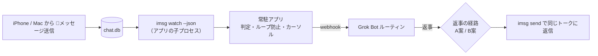

# imsg-grok-bridge 仕様書（引き継ぎ用）

最終更新: 2026-10-26（JST）
ステータス: 設計レビュー済み・未実装（リポジトリ未作成、Mac上でも何も作成・実行していない）

---

## 1. 目的

ちひろさん自身のApple ID（iPhone / Mac など）から送った「🤖」で始まるiMessageを、Mac mini上の常駐アプリが検知してGrok Botに渡し、Grok Botの返事を同じトークにiMessageで返信する。

## 2. 決定済みの要件（ちひろさん決定）

| 項目 | 決定内容 |
|---|---|
| 対象トーク | 全トーク（※ 7章の未決事項2で範囲を再確認中） |
| 発火条件 | 本文が 🤖 で始まるメッセージ |
| 送信者 | 自分のApple IDからの送信のみ（`is_from_me = true`）。他人からのメッセージには反応しない |
| 動作 | メッセージをGrok Botに渡し、返事を同じトークにiMessageで返信 |
| 実装形態 | Macに常駐するMacアプリ（メニューバーアプリ） |
| 開発ツール | Swift の Command Line Tools の導入OK（Xcodeは不要） |
| ソース管理 | GitHub（ChihiroNishioka）にリポジトリを作る。仮名 `imsg-grok-bridge`、非公開 |
| 方針 | sudo を使わない。Keychain は原則使わない（署名証明書のみ例外にするか未決） |

## 3. 実行環境（確認済み）

- Mac mini（ChihironoMac-mini.local）、macOS 27.0.1、arm64、Homebrew 7.0.6
- 導入済みCLI: `imsg` 0.19.1（steipete/tap）、`peekaboo` 4.5.0（steipete/tap）
- Grok Botアプリには フルディスクアクセス / 画面収録 / アクセシビリティ を許可済み（自作アプリには別途許可が必要）
- `imsg` の主なコマンド: `chats`、`history --chat-id N --json`、`watch --json [--chat-id N] --since-rowid <n>`、`send`
- 注意: `/opt/homebrew/bin/imsg` は bash ラッパー。子プロセスとして起動するときは `/opt/homebrew/opt/imsg/libexec/imsg` を直接使う（許可の主体が bash にならないように）

## 4. アーキテクチャ

### 4.1 常駐アプリ
- メニューバーアプリ（`LSUIElement` の `.app`）。App Sandbox は使わない（imsg起動とフルディスクアクセスのため）
- ログイン時起動は `SMAppService.mainApp` で登録（LaunchAgent の plist 不要）
- メニュー表示: 状態、一時停止、最後のエラー、ログを開く
- `imsg watch --json --since-rowid <cursor>` を子プロセスとして起動・監視し、落ちたら再起動
- スリープ対策: システム設定「エネルギー」で、ディスプレイオフ時もスリープしない／ネットワークで復帰／停電後に自動起動。補助として子で `caffeinate -i -s -w <pid>`（caffeinate を親にしない）

### 4.2 判定ロジック
次の3つをすべて満たすときだけ発火:
1. `is_from_me = true`
2. 本文の先頭（先頭空白・VS16 を除いた後）が 🤖
3. 新規メッセージ（edited / unsent などのイベントではない）

あとから🤖に編集したメッセージには反応しない。

### 4.3 重複・取りこぼし防止
- rowid カーソルを保存し、再起動時は `--since-rowid` で続きから読む
- カーソルは条件に合わないメッセージも含めた最大値でのみ更新（巻き戻さない、edited/unsent では動かさない）
- 重複はメッセージの guid を冪等キーにして止める
- webhook 送信の再送は指数バックオフ＋回数上限。失敗分は `deadletter.jsonl` に残す
- 既知の制約: 停止中に起きた編集・取り消しは再起動後も再送されない。`imsg history` は既定50件なので補完時は `--limit` を広めに

### 4.4 ループ防止（自分の送信が対象のため必須）
- ボットの返信は必ず決まった印（例「🗨️ 」）で始める。送信直前に、先頭が🤖なら印を付けて無害化する。これは送信側コードで強制する（ボットへの指示に頼らない）
- アプリが送った返信は送信前に「文面ハッシュ＋時刻」を記録し、watch に戻ってきたものと一致したら無視
- 送信レート上限（例: 1分5件）。超えたらそのトークへの返信を自動停止し、メニューバーに警告

### 4.5 秘密情報・ログ
- webhook のシークレットは `~/.config/imsg-bridge/secret`（ディレクトリ700、ファイル600）。plist や引数・環境変数に入れない。送信のたびに読み直す（差し替えに再起動不要）
- ログに本文を書かない。webhook に送る中身は最小限

### 4.6 許可と署名
- フルディスクアクセスは `.app` に付与。子の imsg はその許可で読める見込み（要実機確認）
- オートメーション（Messages 操作）: Info.plist に `NSAppleEventsUsageDescription`。Hardened Runtime なら apple-events entitlement。初回送信時に許可ダイアログが1回出る
- アドホック署名（`codesign -s -`）は再ビルドのたびに許可が外れる。保つには安定した署名ID（自己署名 or Apple Development 証明書、いずれもKeychain）が必要 → 未決事項4
- ビルド: `swift build` → スクリプトで `.app` を組み立て → Info.plist 配置 → codesign。ローカルビルドなので quarantine は付かない

## 5. 返事の経路（未決・事前確認次第）

| 案 | 内容 | 長所 | 短所 |
|---|---|---|---|
| A | ボットがMac上で `imsg send` を実行 | いちばん簡単 | 無人のルーティン実行中にMacのコマンド実行が承認待ちで止まるおそれ。Grok Botアプリ側にオートメーション許可が要る |
| B（エンジニア推奨） | ボットが返事を決まった場所（非公開GitHubリポジトリのファイルやissueコメント等）に書き、アプリが定期取得して送信 | 送信直前にアプリで検査でき、ループ防止を確実にできる | 5〜15秒程度の遅れ。トークンがもう1つ必要 |
| C（不採用） | 伝書鳩のLinq番号から返信 | — | 別番号になり同じトークに返せないため要件外 |

## 6. 開発の進め方

0. **実機での事前確認**（Apple Mac Tools が担当）
   1. ルーティン実行中に Mac で `imsg send` が承認なしで通るか
   2. iPhone から送った🤖が watch に `is_from_me=1` で届くか、遅延はどのくらいか
   3. `imsg send` でグループのトークに chat_id 指定で送れるか
   ※ 実際にメッセージを送るので、送り先（自分だけのトーク等）をちひろさんが指定してから行う
1. リポジトリ作成（エンジニア）: 名前と公開設定をちひろさんに報告してから作る
2. 中心処理を Swift Package として実装（判定・カーソル・ループ防止・冪等・レート上限）。NDJSON サンプルでテスト、GitHub Actions の macOS ランナーで CI（非公開リポジトリは無料枠の消費に注意）
3. メニューバーアプリ実装（状態・一時停止・最後のエラー・ログ・ログイン時起動）
4. Mac mini に導入、許可付与、端から端まで試験、手順書作成（Apple Mac Tools）

クラウドエージェント（Linux）では AppKit/SwiftUI のビルド・実行、許可付与、chat.db 読み取り、実送信、UI確認はできない。これらは Mac mini 実機で行う。Mac mini を Cursor の専用ワーカーとして登録すれば実機でのビルド・テストも可能（許可付与だけは手作業）。

## 7. 未決事項（ちひろさんに決めてもらうこと）

1. 返事の経路: A案（ボットがMacで送る）か B案（アプリが取りに行って送る）か。事前確認の結果を見てからでも可
2. 返信してよいトークの範囲: 全トークか、許可リストか（推奨は許可リスト。全トークだと相手のいるトークで🤖と打った場合、ボットの返事がちひろさん名義で相手に届く）
3. 返信の先頭に付ける印（例: 🗨️）
4. 署名: 更新のたびに許可を付け直す運用か、署名用証明書だけ Keychain を使うか
5. リポジトリ名（仮: `imsg-grok-bridge`、非公開）
6. Grok Bot に何をさせるか（返事の内容・どのボットが担当するか）と、本文をそのままwebhookに送ってよいか
7. FileVault の使用有無と、再起動後の自動ログインを許せるか

## 8. 実機で未確認のこと

- 親アプリに許可があれば子の imsg も chat.db を読めるか
- brew upgrade やアプリ再ビルド後に許可が保たれるか
- FileVault 有効時の自動ログインの挙動
- macOS 27 の「エネルギー」設定の項目名
- caffeinate に sudo が要らないか
- Grok Bot の webhook の仕様（応答に返事が載らない前提）
- iPhone からの🤖が Mac の chat.db に届くまでの遅延

## 9. 関連資料

- 詳細設計案（ClaudeCodexConnector 作成）: `/workspace/cc/imsg-webhook/design.md`（plist サンプル・ブリッジ骨子・出典つき）
- レビュー: エンジニア（2026-10-26、結論「条件付きで作れる」）
