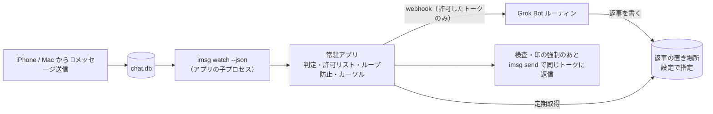

# genie-in-messages 仕様書（引き継ぎ用）

最終更新: 2026-10-26（JST、未決事項をすべて決定に反映）
ステータス: 要件確定・未実装（リポジトリ `genie-in-messages` は作成済み。Mac上ではまだ何も作成・実行していない）

旧仮名: `imsg-grok-bridge`

次にやること: 6章の0「実機での事前確認」（Apple Mac Tools が担当）

---

## 1. 目的

利用者自身のApple ID（iPhone / Mac など）から送った、呼び出しの合図（🧞 / 🧞‍♀️ / 🧞‍♂️）で始まるiMessageを、Mac上の常駐アプリが検知してGrok Botに渡し、Grok Botの返事を同じトークにiMessageで返信する。最初の利用者はちひろさん。

## 2. 決定済みの要件（ちひろさん決定）

| 項目 | 決定内容 |
|---|---|
| 対象トーク | 許可リスト制。メニューバーアプリでトークごとにオン・オフ。初期状態は全部オフ（4.7参照） |
| 発火条件 | 本文が合図 🧞 / 🧞‍♀️ / 🧞‍♂️ のどれかで始まるメッセージ（4.2参照。旧案の🤖は廃止） |
| 送信者 | 自分のApple IDからの送信のみ（`is_from_me = true`）。他人からのメッセージには反応しない |
| 動作 | メッセージをGrok Botに渡し、返事を同じトークにiMessageで返信 |
| 返事の経路 | B案。ボットは返事を決まった場所に書き、アプリが定期的に取りに行って、検査してから送る（5章） |
| 返信の印 | 先頭に「🗨️🧞‍♂️」（4.4参照） |
| ボットの役割 | 何でも答える汎用アシスタント。担当は Grok Bot、受け口は webhook で起動するルーチン（4.5参照） |
| 実装形態 | Macに常駐するMacアプリ（メニューバーアプリ） |
| 開発ツール | Swift の Command Line Tools の導入OK（Xcodeは不要） |
| ソース管理 | GitHub `ChihiroNishioka/genie-in-messages`（非公開） |
| 方針 | sudo を使わない。Keychain は署名用の証明書だけ使う（4.6参照）。それ以外の秘密は Keychain に入れない |
| 動かすMac | 同じApple IDで動かすMacは常に1台だけ（4.8参照） |

## 3. 実行環境（確認済み）

以下はちひろさんの環境の例。ホスト名やバージョンをコードや設定の前提にしない。

- Mac mini（例: ChihironoMac-mini.local）、macOS 27.0.1、arm64、Homebrew 7.0.6
- 導入済みCLI: `imsg` 0.19.1（steipete/tap）、`peekaboo` 4.5.0（steipete/tap）
- Grok Botアプリには フルディスクアクセス / 画面収録 / アクセシビリティ を許可済み（自作アプリには別途許可が必要）
- FileVault は使っていない。再起動後の自動ログインは許可（自宅に置いている前提で、物理的に触れられるリスクは承知のうえ）
- `imsg` の主なコマンド: `chats`、`history --chat-id N --json`、`watch --json [--chat-id N] --since-rowid <n>`、`send`
- 注意: `/opt/homebrew/bin/imsg` は bash ラッパー。子プロセスとして起動するときは `/opt/homebrew/opt/imsg/libexec/imsg` を直接使う（許可の主体が bash にならないように）

## 4. アーキテクチャ

### 4.1 常駐アプリ
- メニューバーアプリ（`LSUIElement` の `.app`）。App Sandbox は使わない（imsg起動とフルディスクアクセスのため）
- ログイン時起動は `SMAppService.mainApp` で登録（LaunchAgent の plist 不要）
- メニュー表示: 状態、一時停止、トーク一覧（許可リストのオン・オフ）、最後のエラー、ログを開く
- `imsg watch --json --since-rowid <cursor>` を子プロセスとして起動・監視し、落ちたら再起動
- スリープ対策: システム設定「エネルギー」で、ディスプレイオフ時もスリープしない／ネットワークで復帰／停電後に自動起動。補助として子で `caffeinate -i -s -w <pid>`（caffeinate を親にしない）

### 4.2 判定ロジック
次の4つをすべて満たすときだけ発火:
1. `is_from_me = true`
2. 本文の先頭（先頭の空白と VS16〈U+FE0F〉を無視した後）が、次の合図のどれかで始まる
   - 🧞（U+1F9DE）
   - 🧞‍♀️（U+1F9DE U+200D U+2640。末尾の U+FE0F はあってもなくても可）
   - 🧞‍♂️（U+1F9DE U+200D U+2642。末尾の U+FE0F はあってもなくても可）
3. 新規メッセージ（edited / unsent などのイベントではない）
4. そのトークが許可リストでオンになっている（4.7）

あとから合図付きに編集したメッセージには反応しない。

ジーニーの絵文字は🧞・🧞‍♀️・🧞‍♂️の3つで全部（🧞は肌の色を変えられない絵文字なので、ほかの変化形はない）。

旧案の🤖は合図として使わない。

### 4.3 重複・取りこぼし防止
- rowid カーソルを保存し、再起動時は `--since-rowid` で続きから読む
- カーソルは条件に合わないメッセージも含めた最大値でのみ更新（巻き戻さない、edited/unsent では動かさない）
- 重複はメッセージの guid を冪等キーにして止める
- webhook 送信の再送は指数バックオフ＋回数上限。失敗分は `deadletter.jsonl` に残す（本文は残さない）
- 既知の制約: 停止中に起きた編集・取り消しは再起動後も再送されない。`imsg history` は既定50件なので補完時は `--limit` を広めに

### 4.4 ループ防止（自分の送信が対象のため必須）
- ボットの返信は必ず印「🗨️🧞‍♂️」（2文字）で始める。印は設定から読む（4.9）
- 返信の先頭をジーニーの絵文字にしない。印は🗨️で始まるので、合図には当たらない
- 送信直前に、送信側のコードで次を強制する（ボットへの指示に頼らない）
  - 返信の先頭（先頭の空白と VS16 を無視した後）が合図のどれかで始まっていたら、無害化する（判定は4.2と同じ関数を使う）
  - 返信の先頭が🗨️であること。印が付いていなければ付ける
- アプリが送った返信は送信前に「文面ハッシュ＋時刻」を記録し、watch に戻ってきたものと一致したら無視
- 送信レート上限（例: 1分5件）。超えたらそのトークへの返信を自動停止し、メニューバーに警告

### 4.5 ボットとの受け渡し・秘密情報・ログ
- 受け取るのは Grok Bot の、webhook で起動するルーチン。役割は何でも答える汎用アシスタント
- 本文はそのまま webhook に送ってよい。ただし送るのは許可リストでオンのトークのメッセージだけ
- アプリのログ（`deadletter.jsonl` を含む）に本文を残さない
- webhook のシークレットは設定ディレクトリ（例: `~/.config/genie-in-messages/`、ディレクトリ700）の `secret`（600）。plist や引数・環境変数に入れない。送信のたびに読み直す（差し替えに再起動不要）

### 4.6 許可と署名
- フルディスクアクセスは `.app` に付与。子の imsg はその許可で読める見込み（要実機確認）
- オートメーション（Messages 操作）: Info.plist に `NSAppleEventsUsageDescription`。Hardened Runtime なら apple-events entitlement。初回送信時に許可ダイアログが1回出る
- 署名: 署名用の証明書だけ Keychain に入れ、安定した署名IDで許可を保つ。ちひろさんは Apple Developer Program 会員なので、Apple Development 証明書を使う。アドホック署名（`codesign -s -`）は再ビルドのたびに許可が外れるので使わない
- ビルド: `swift build` → スクリプトで `.app` を組み立て → Info.plist 配置 → codesign。ローカルビルドなので quarantine は付かない
- 配布（後の段階）: 他の人に配るときは Developer ID で署名し、公証（notarization）を通す。今は仕様に書くだけで、実装しない

### 4.7 許可リスト
- メニューバーアプリにトーク一覧（`imsg chats --json`）を出し、トークごとにオン・オフを切り替える
- 初期状態は全部オフ。オンにしたトークだけが判定（4.2）とボットへの受け渡しの対象
- 許可していないトークのメッセージはボットに渡さない
- トークの識別には `chat.ROWID`（`imsg chats` の `id`）を使う。表示名は変わることがあるので使わない

### 4.8 動かすMacは1台だけ
- 同じApple IDで動かすMacは常に1台だけにする。iCloud同期で同じメッセージが複数のMacの chat.db に届き、二重に返信してしまうため
- 導入手順と画面で「同じApple IDのほかのMacでは動かさない」と明記する
- 検討事項: ブリッジ側で guid を使って複数台の重複を止める方法（例: 処理済み guid を共有の場所に記録して先着1台だけが処理する）。1台運用の補助として設計で検討する

### 4.9 設定と利用者ごとの分離
- ちひろさん専用の値をコードに直接書かない。次はすべて設定から読む
  - webhook のURL、シークレット、返事を取りに行く場所、許可リスト、返信の印
- 別の人が使うときは、その人自身のMac、Apple ID、Grok Botで動かす。ちひろさんの Grok Bot にはつながない

## 5. 返事の経路（決定: B案）

ボットは返事を決まった場所に書き、Macのアプリがそれを定期的に取りに行って、送る前に中身を検査してから送る。

| 案 | 内容 | 判断 |
|---|---|---|
| A | ボットがMac上で `imsg send` を実行 | 不採用。無人のルーティン実行中にMacのコマンド実行が承認待ちで止まるおそれがあり、送信前の検査もアプリでできない |
| B | ボットが返事を決まった場所に書き、アプリが定期取得して検査のうえ送信 | 採用。送信直前にアプリで検査でき、ループ防止を確実にできる。5〜15秒程度の遅れと、置き場所を読むためのトークンがもう1つ要る |
| C | 伝書鳩のLinq番号から返信 | 不採用。別番号になり同じトークに返せないため要件外 |

返事を置く具体的な場所（非公開リポジトリのファイルか issue コメントか、など）は設計で決める。置き場所は設定から読む（4.9）。

## 6. 開発の進め方

0. **実機での事前確認**（Apple Mac Tools が担当、次にやること）
   1. アプリ（またはその子の imsg）から `imsg send` で、承認なしで送れるか
   2. iPhone から送った🧞が watch に `is_from_me=1` で届くか、遅延はどのくらいか
   3. 送り先はちひろさん自身だけのトーク。他人がいるトークでは試さない。グループでの送信確認が必要になったら、そのときまたちひろさんに確認する
1. リポジトリ作成（エンジニア）: 済み（`genie-in-messages`、非公開）
2. 中心処理を Swift Package として実装（判定・許可リスト・カーソル・ループ防止・冪等・レート上限・設定読み込み）。NDJSON サンプルでテスト、GitHub Actions の macOS ランナーで CI（非公開リポジトリは無料枠の消費に注意）
3. メニューバーアプリ実装（状態・一時停止・トーク一覧の許可リスト・最後のエラー・ログ・ログイン時起動）
4. Mac に導入、Apple Development 証明書で署名、許可付与、端から端まで試験、手順書作成（Apple Mac Tools）。手順書には再起動後の自動ログインの設定と、「同じApple IDのほかのMacでは動かさない」ことを入れる

クラウドエージェント（Linux）では AppKit/SwiftUI のビルド・実行、許可付与、chat.db 読み取り、実送信、UI確認はできない。これらは Mac 実機で行う。Mac を Cursor の専用ワーカーとして登録すれば実機でのビルド・テストも可能（許可付与だけは手作業）。

## 7. 決定事項（2026-10-26、ちひろさん決定）

1. 返事の経路: 決定。B案（5章）。A案は不採用。返事を置く具体的な場所は設計で決める
2. 返事していいトーク: 決定。許可リスト制。メニューバーアプリでトークごとにオン・オフ、初期状態は全部オフ。許可していないトークのメッセージはボットに渡さない（4.7）
3. 返信の印: 決定。先頭に「🗨️🧞‍♂️」（2文字）。返信の先頭をジーニーの絵文字にしない。印は🗨️で始まるので、合図には当たらない。無害化と先頭が🗨️であることの強制は送信側のコードで行う（4.4）
4. 署名: 決定。署名用の証明書だけ Keychain に入れ、安定した署名IDで許可を保つ。Apple Development 証明書を使う（4.6）
5. ボットの役割: 決定。何でも答える汎用アシスタント。担当は Grok Bot、受け口は webhook で起動するルーチン。本文はそのまま送ってよいが、許可したトークのメッセージだけ。アプリのログに本文は残さない（4.5）
6. FileVault: 決定。使っていない。再起動後の自動ログインは許可。導入手順に自動ログインの設定を入れる
7. 実機での事前確認の送り先: 決定。ちひろさん自身だけのトーク。他人がいるトークでは試さない（6章の0）
8. リポジトリ名: 決定。`genie-in-messages`（非公開）
9. 呼び出しの合図: 決定。🧞 / 🧞‍♀️ / 🧞‍♂️ の3つ（4.2）。旧案の🤖は廃止

## 8. 実機で未確認のこと

- 親アプリに許可があれば子の imsg も chat.db を読めるか
- Apple Development 証明書で署名し直したあと、brew upgrade やアプリ再ビルドの後も許可が保たれるか
- macOS 27 の「エネルギー」設定の項目名
- caffeinate に sudo が要らないか
- Grok Bot の webhook の仕様（応答に返事が載らない前提）
- iPhone からの🧞が Mac の chat.db に届くまでの遅延

## 9. 関連資料

- 詳細設計案（ClaudeCodexConnector 作成）: `docs/design.md`（初期の🐦トーク向け LaunchAgent 案。plist サンプル・ブリッジ骨子・出典つき。現在の方針はこの仕様書が正）
- レビュー: エンジニア（2026-10-26、結論「条件付きで作れる」）
