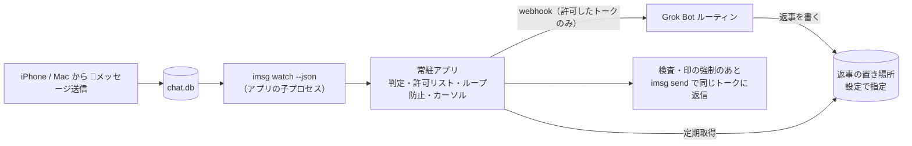

# genie-in-messages 仕様書（引き継ぎ用）

最終更新: 2026-10-26（JST、実機での事前確認の結果、レビュー対応、返事の置き場所 Notion を反映）
ステータス: 要件確定・実機での事前確認済み・実装開始（2026-10-26 13:20 JST、ちひろさんが「ロックしないで使う、作り始めて」とOK）

旧仮名: `imsg-grok-bridge`

次にやること: 6章の2・3「中心処理とメニューバーアプリの実装」（エンジニア）

---

## 1. 目的

利用者自身のApple ID（iPhone / Mac など）から送った、呼び出しの合図（🧞 / 🧞‍♀️ / 🧞‍♂️）で始まるiMessageを、Mac上の常駐アプリが検知してGrok Botに渡し、Grok Botの返事を同じトークにiMessageで返信する。最初の利用者はちひろさん。

## 2. 決定済みの要件（ちひろさん決定）

| 項目 | 決定内容 |
|---|---|
| 対象トーク | 許可リスト制。メニューバーアプリでトークごとにオン・オフ。初期状態は全部オフ（4.7参照） |
| 発火条件 | 本文が合図 🧞 / 🧞‍♀️ / 🧞‍♂️ のどれかで始まるメッセージ（4.2参照。旧案の🤖は廃止） |
| 送信者 | 自分のApple IDからの送信のみ（`is_from_me = true`）。他人からのメッセージには反応しない |
| 動作 | メッセージをGrok Botに渡し、返事を同じトークにiMessageで返信 |
| 返事の経路 | B案。ボットは返事を決まった場所に書き、アプリが定期的に取りに行って、検査してから送る。置き場所は Notion のデータベース（5章） |
| 返信の印 | 先頭に「🗨️🧞‍♂️」（4.4参照） |
| ボットの役割 | 何でも答える汎用アシスタント。担当は Grok Bot、受け口は webhook で起動するルーチン（4.5参照） |
| 実装形態 | Macに常駐するMacアプリ（メニューバーアプリ） |
| 開発ツール | Swift の Command Line Tools の導入OK（Xcodeは不要） |
| ソース管理 | GitHub `ChihiroNishioka/genie-in-messages`（非公開） |
| 方針 | sudo を使わない。Keychain は署名用の証明書だけ使う（4.6参照）。それ以外の秘密は Keychain に入れない |
| 動かすMac | 同じApple IDで動かすMacは常に1台だけ（4.8参照） |

## 3. 実行環境（確認済み）

以下はちひろさんの環境の例。ホスト名やバージョンをコードや設定の前提にしない。

- Mac mini（例: ChihironoMac-mini.local）、macOS 27.0.1、arm64、Homebrew 7.0.6
- 導入済みCLI: `imsg` 0.19.1（steipete/tap）、`peekaboo` 4.5.0（steipete/tap）
- Grok Botアプリには フルディスクアクセス / 画面収録 / アクセシビリティ を許可済み（自作アプリには別途許可が必要）
- FileVault は使っていない。再起動後の自動ログインは許可（自宅に置いている前提で、物理的に触れられるリスクは承知のうえ）
- `imsg` の主なコマンド: `chats`、`history --chat-id N --json`、`watch --json [--chat-id N] --since-rowid <n>`、`send`
- 注意: `/opt/homebrew/bin/imsg` は bash ラッパー。子プロセスとして起動するときは `/opt/homebrew/opt/imsg/libexec/imsg` を直接使う（許可の主体が bash にならないように）

## 4. アーキテクチャ

### 4.1 常駐アプリ
- メニューバーアプリ（`LSUIElement` の `.app`）。App Sandbox は使わない（imsg起動とフルディスクアクセスのため）
- ログイン時起動は `SMAppService.mainApp` で登録（LaunchAgent の plist 不要）
- メニュー表示: 状態、一時停止、トーク一覧（許可リストのオン・オフ）、最後のエラー、ログを開く
- `imsg watch --json --since-rowid <cursor>` を子プロセスとして起動・監視し、落ちたら再起動
- 送信: `imsg send --chat-id <id>` を子プロセスで実行する（AppleScriptでMessagesを操作する。8.2）
- 画面ロック: Mac mini は画面をロックしない運用にする。送信前にロック状態を確認し、ロック中なら送らずに保留して再試行する。保留中はメニューバーに警告を出す
  - ロック状態は「ロック / 解除 / 不明」の3つ。CoreGraphics の `CGSessionCopyCurrentDictionary` を直接呼び（dlsym は使わない）、通知 `com.apple.screenIsLocked` / `com.apple.screenIsUnlocked` も併用する。辞書にキーが無ければ解除、辞書が取れなければ不明
  - 不明のときは送信を試し、メニューに出す（判定が常に不明だと全送信が止まるため）
  - 安全網: 送信結果が `not_started`（-1712 と一緒に出る）なら保留して再試行する。-1712 だけで `not_started` が無い結果は結果不明として再送しない
- 子プロセスの期限: send は 150 秒（`send_timeout_seconds`）、chats は 30 秒（`chats_timeout_seconds`）。期限を過ぎたら SIGTERM を送り、それでも止まらなければ SIGKILL で終わらせる。期限を超えた送信は結果不明として扱い、再送しない
- 本文の渡し方: `imsg send --text` のまま（本文が `ps` に見える）。imsg 0.19.1 の send には本文を標準入力やファイルで渡す口が無い（`--file` は添付）。既知の制約として受け入れる
- SIPの無効化が必要な IMCore ブリッジは使わない
- スリープ対策: システム設定「エネルギー」で、ディスプレイオフ時もスリープしない／ネットワークで復帰／停電後に自動起動。補助として子で `caffeinate -i -s -w <pid>`（caffeinate を親にしない）

### 4.2 判定ロジック
判定の前に、本文をNFCに正規化する（8.4）。

次の4つをすべて満たすときだけ発火:
1. `is_from_me = true`（自分宛てトークで重複して記録される `is_from_me = false` 側は常に無視する。8.3）
2. 本文の先頭（先頭の空白と VS16〈U+FE0F〉を無視した後）が、次の合図のどれかで始まる
   - 🧞（U+1F9DE）
   - 🧞‍♀️（U+1F9DE U+200D U+2640。末尾の U+FE0F はあってもなくても可）
   - 🧞‍♂️（U+1F9DE U+200D U+2642。末尾の U+FE0F はあってもなくても可）
3. 新規メッセージ（edited / unsent などのイベントではない）
4. そのトークが許可リストでオンになっている（4.7）

あとから合図付きに編集したメッセージには反応しない。

iPhoneから届いた実際の形は 🧞‍♂️ = U+1F9DE U+200D U+2642 U+FE0F だった（8.4）。U+1F9DE のあとに ZWJ・性別記号・VS16 が続く形は上の規則で受け付ける。

ジーニーの絵文字は🧞・🧞‍♀️・🧞‍♂️の3つで全部（🧞は肌の色を変えられない絵文字なので、ほかの変化形はない）。

旧案の🤖は合図として使わない。

### 4.3 重複・取りこぼし防止
- rowid カーソルを保存し、再起動時は `--since-rowid` で続きから読む
- カーソルは条件に合わないメッセージも含めた最大値でのみ更新（巻き戻さない、edited/unsent では動かさない）
- 重複はメッセージの guid を冪等キーにして止める
- 確実に送れていない失敗と、途中で落ちた送信（次の起動で `send_interrupted` として記録）は、本文なしで deadletter に残す。watch の行は、deadletter を書けたときだけ処理済みにし、書けなかった行はカーソルも既読 guid も進めない。返事の送信が途中で落ちたときは、deadletter を書けなくてもその `reply_id` を処理済みにし、同じ返事を二重に送らない。deadletter の書き込みは次の起動でやり直す
- 一時停止中や書き込みに失敗したあとは、同じ watch の続きでカーソルを進めない
- 1MB を超える watch 行は本文を捨てる。rowid が取れれば deadletter に残してカーソルを進め、取れなければ止める
- Messages の DB が入れ替わって、同じ ROWID の guid が変わったら、許可リスト・送り先の対応表・カーソルを捨てる（ROWID が別のトークを指すのを防ぐ）
- 自分宛てトークでは1通ごとに `is_from_me=true` と `is_from_me=false` の2件が別の rowid・guid で記録される。`is_from_me=false` 側は常に無視する。`created_at` の一致では重複を判定しない（ずれることがあり、受信側の rowid が後になることもある。8.3）
- 比較・ハッシュの前に本文をNFCに正規化する（8.4）
- webhook 送信の再送は指数バックオフ＋回数上限。失敗分は `deadletter.jsonl` に残す（本文は残さない）
- 既知の制約: 停止中に起きた編集・取り消しは再起動後も再送されない。`imsg history` は既定50件なので補完時は `--limit` を広めに

### 4.4 ループ防止（自分の送信が対象のため必須）
- ボットの返信は必ず印「🗨️🧞‍♂️」（2文字）で始める。印は設定から読む（4.9）
- 返信の先頭をジーニーの絵文字にしない。印は🗨️で始まるので、合図には当たらない
- 送信直前に、送信側のコードで次を強制する（ボットへの指示に頼らない）
  - 返信の先頭（先頭の空白と VS16 を無視した後）が合図のどれかで始まっていたら、無害化する（判定は4.2と同じ関数を使う）
  - 返信の先頭が🗨️であること。印が付いていなければ付ける
- `imsg send` が返した guid（`{"id":..,"status":"sent","guid":..}`）を記録し、watch に戻ってきた同じ guid のメッセージには反応しない
- 補助として、送信前に「文面ハッシュ（NFC正規化後）＋時刻」を記録し、watch に戻ってきたものと一致したら無視
- 印🗨️（U+1F5E8 U+FE0F）を先頭にする対策と、上の guid 記録・`is_from_me=false` 側の無視を併用する
- 返信の印が U+1F5E8 で始まらなければ、製品既定の 🗨️🧞‍♂️ に置き換えてから送る
- 返事の ID は送信の前に予約する。レート停止の解除と返事の取得が重なっても、1回しか送らない
- 送信レート上限（例: 1分5件）。送ると決めた時点で枠を予約する。送信の完了を待たずに、並行する取得や保留の再送が同じ枠を使えない。送れなかったとき（起動前の失敗、送信失敗）は予約を戻す。結果不明の送信は予約を戻さない。超えたらそのトークへの返信を自動停止し、メニューバーに警告。停止の解除は停止フラグだけを外し、窓の中の送信回数は残す

### 4.5 ボットとの受け渡し・秘密情報・ログ
- 受け取るのは Grok Bot の、webhook で起動するルーチン。役割は何でも答える汎用アシスタント
- 本文はそのまま webhook に送ってよい。ただし送るのは許可リストでオンのトークのメッセージだけ
- アプリのログ（`deadletter.jsonl` を含む）に本文を残さない
- webhook に渡す前に、メッセージの guid とトークの chat_id の対応を state に保存する（既定 7 日、`route_ttl_seconds`）。返事の送り先はこの対応から決める（5.1）
- webhook の各試行と、保留中の返事の再送のたびに、外に出す直前に許可リストと一時停止を確かめ直す。保留の再送では、返事の `created_at` が `route_ttl_seconds` より古くないかを確かめる（対応を保存した時刻ではない。差は返事ができるまでの数秒から数分で、期限の既定 7 日に比べて小さい）。期限を過ぎた保留は送らず処理済みにする。オフにしたトークの保留は捨てる
- webhook の認証は Bearer。本文 JSON に `idempotency_key`（メッセージの guid）を入れる（`Idempotency-Key` ヘッダはボットに届かないため）
- 通信は `URLSession.shared` を使わず、キャッシュしないセッションを使う。空でない URL は https だけ
- webhook のシークレットは設定ディレクトリ（例: `~/.config/genie-in-messages/`、ディレクトリ700）の `secret`（600）。plist や引数・環境変数に入れない。送信のたびに読み直す（差し替えに再起動不要）
- Notion のトークンも同じ扱い。`notion-token`（600）に置き、使うたびに読み直す。メニューの「Notion トークンを設定」から入れ、画面には出さない。状態表示は「設定済み」「未設定」「権限が 600 ではありません」だけ。Keychain は使わない
- GET JSON の取得元を使うときのトークンは任意の `reply-secret`（600）

### 4.6 許可と署名
- フルディスクアクセスは `.app` に付与。子の imsg はその許可で読める見込み（要実機確認）
- オートメーション（Messages 操作）: Info.plist に `NSAppleEventsUsageDescription`。Hardened Runtime なら apple-events entitlement。初回送信時に許可ダイアログが1回出る。自作アプリから imsg を起動すると、Grok Bot アプリで許可済みでも改めて許可を求められる見込みなので、初回の設定手順に入れる
- 署名: 署名用の証明書だけ Keychain に入れ、安定した署名IDで許可を保つ。ちひろさんは Apple Developer Program 会員なので、Apple Development 証明書を使う。アドホック署名（`codesign -s -`）は再ビルドのたびに許可が外れるので使わない
- ビルド: `swift build` → スクリプトで `.app` を組み立て → Info.plist 配置 → codesign。ローカルビルドなので quarantine は付かない
- 配布（後の段階）: 他の人に配るときは Developer ID で署名し、公証（notarization）を通す。今は仕様に書くだけで、実装しない

### 4.7 許可リスト
- メニューバーアプリにトーク一覧（`imsg chats --json`）を出し、トークごとにオン・オフを切り替える
- 初期状態は全部オフ。オンにしたトークだけが判定（4.2）とボットへの受け渡しの対象
- 許可していないトークのメッセージはボットに渡さない
- トークの識別には `chat.ROWID`（`imsg chats` の `id`）を使う。表示名は変わることがあるので使わない

### 4.8 動かすMacは1台だけ
- 同じApple IDで動かすMacは常に1台だけにする。iCloud同期で同じメッセージが複数のMacの chat.db に届き、二重に返信してしまうため
- 導入手順と画面で「同じApple IDのほかのMacでは動かさない」と明記する
- 検討事項: ブリッジ側で guid を使って複数台の重複を止める方法（例: 処理済み guid を共有の場所に記録して先着1台だけが処理する）。1台運用の補助として設計で検討する

### 4.9 設定と利用者ごとの分離
- ちひろさん専用の値をコードに直接書かない。次はすべて設定から読む
  - webhook のURL、シークレット、返事を取りに行く場所、許可リスト、返信の印
  - `config.json` の主な項目: `notion_data_source_id`、`route_ttl_seconds`（既定 604800）、`send_timeout_seconds`、`chats_timeout_seconds`、`reply_page_limit`（既定 100）
- 別の人が使うときは、その人自身のMac、Apple ID、Grok Botで動かす。ちひろさんの Grok Bot にはつながない

## 5. 返事の経路（決定: B案）

ボットは返事を決まった場所に書き、Macのアプリがそれを定期的に取りに行って、送る前に中身を検査してから送る。

| 案 | 内容 | 判断 |
|---|---|---|
| A | ボットがMac上で `imsg send` を実行 | 不採用。無人のルーティン実行中にMacのコマンド実行が承認待ちで止まるおそれがあり、送信前の検査もアプリでできない |
| B | ボットが返事を決まった場所に書き、アプリが定期取得して検査のうえ送信 | 採用。送信直前にアプリで検査でき、ループ防止を確実にできる。5〜15秒程度の遅れと、置き場所を読むためのトークンがもう1つ要る |
| C | 伝書鳩のLinq番号から返信 | 不採用。別番号になり同じトークに返せないため要件外 |

返事を置く場所は Notion のデータベースに決定（2026-10-26 14:35 JST、ちひろさん決定）。置き場所は設定から読む（4.9）。

### 5.1 Notion のデータベース（既定の取得元）
- ボット（Grok Bot の webhook ルーチン）が、Notion コネクターで返事1件につき1行を足す
- Mac は、このデータベースだけを共有した Notion の内部連携トークンで、約10秒ごとに読む（読むだけの権限を想定）
- 列: `reply_id`（title、一意、Mac の冪等キー）、`chat_id`（number、確認用。整数。小数や Int64 にぴったり入らない値の行は送らない）、`in_reply_to_guid`（rich_text、必須）、`idempotency_key`（rich_text、Mac は使わない）、`text`（rich_text、先頭は🗨️🧞‍♂️）、`created_at`（created_time）
- 取得: `POST https://api.notion.com/v1/data_sources/{id}/query`、`Notion-Version: 2026-03-11`。created_time の古い順、`start_cursor` でページング。毎回、created_time が読み始め以降の行だけを問い合わせる。1回の取得は最大 20 ページ（2000 行）まで
- 読み始めは、保存した水位の 120 秒前。ただし、カーソルを作り始めた分の先頭より前には戻さない。水位は、その取得で読み終えた行のうち最も新しい `created_at`。同じ `reply_id` は、処理済み ID と、水位とともに覚えた ID で落とす。1回に扱う新しい返事は `reply_page_limit`（既定 100）まで。処理済みの行と、いま保留中・送信中の返事は、この件数に数えない
- カーソルが空のとき（初回起動、state の隔離や作り直し）は、表の先頭ではなく、その取得を始めたときの今の分の先頭から読む。取得の途中で分が変わっても、読み始めは動かさない。対応表も空なので、それより古い行は送らない
- 処理済みでない返事（レート停止や画面ロックで保留したもの、送信の途中のもの）があるあいだは、水位をその返事の `created_at` より新しい時刻にしない。再起動してもその行は読み直す。保留中と送信中の ID は 100 件に数えないので、保留が 100 件を超えても、より新しい返事は届く。再起動の直後は保留がメモリから消えているので、最初の取得ではその行を件数に数える
- 保留で水位が止まっているあいだに、その後ろへ 2000 行を超えて返事がたまると、超えた分はその取得では届かない。保留が送れるようになるか、対応の期限で捨てられるまで続く。120 秒の読み直し幅の中だけで 2000 行を超えることは、個人の利用では想定しない
- 処理済み ID は最大 5000 件。あふれたら古いものから捨てる。ただしカーソルが覚えている読み直し幅（水位の 120 秒前以降）の ID は、枠が足りる限り先には捨てない。120 秒のあいだに 5000 件を超えることは想定しない
- Notion API の上限（平均で毎秒3回）を守る。リクエストの間は 1/3 秒以上空ける。429 と 529 は `Retry-After`（無いときは指数バックオフ、いずれも上限 60 秒）を待って最大 5 回試す。5 回目も待ってから、その取得を打ち切る。500 と 503 も同じ回数だけ待って試す
- 送り先は、webhook のときに保存した guid → chat_id の対応から決める。対応が無い、`chat_id` が対応と食い違う、必須列（`reply_id`・`in_reply_to_guid`・`text`・`created_at`）が欠けている、期限（`route_ttl_seconds`）より古い返事は送らない。初回起動や state を作り直したあとに古い返事をまとめて送ることもない
- データベースIDとデータソースIDはコードに書かない（`notion_data_source_id` に設定）
- ボットが守ること
  - 1行は、全部の列が揃った状態で一度に作る。作ったあとで本文や guid を埋めても、Mac は欠けていた行を読み直さない
  - `in_reply_to_guid` は必須。`reply_id`、`text`、`created_at` も必須
  - `chat_id` は整数にする
  - 対応の期限（`route_ttl_seconds`、既定 7 日）より古い行を定期的に片付ける。Mac は行を消さない
  - 片付けてよいのは、その期限より古い行だけ。読み直し幅は 120 秒だが、レート停止などで保留した返事は、再起動すると表から読み直す。120 秒より少し古い行を消すと、その再起動で本文が無くなる。片付けは読み直し幅ではなく、対応の期限に合わせる

### 5.2 予備の取得元: GET JSON
- `notion_data_source_id` が空のときは、設定した URL を GET する取得元を使う（差し替え用に残す）
- 形: `{ "v": 1, "cursor", "replies": [{ "id", "chat_id", "in_reply_to_guid", "text", "created_at" }] }`。`in_reply_to_guid` と `created_at` は必須。`reply-secret` があれば Bearer。取得間隔の既定は10秒。壊れた要素は飛ばしてログに残す（本文は出さない）

### 5.3 読み終えた行の片付け
- Mac は行を消さない（読むだけのトークンでは消せない）。通常の件数では、正しさは削除に依存しない。保留で水位が止まっているあいだに読み直しの範囲が 2000 行を超えると、それより後ろは読めない（5.1）
- ボット側の定期処理で、対応表の期限（既定7日）より古い行を片付ける
- 読み直しは水位の 120 秒前からだが、未処理の返事があるあいだ水位はその返事より前に留まる。期限より前に消すと、再起動でその返事の本文を読めなくなる（5.1）

### 5.4 ボット側が止まっているとき
- Grok Bot 側（箱やルーチン）が止まっていると、返事の行は作られない。Mac は返事を待つだけで、誤送信はしない
- webhook を送り直せば戻せる。本文の `idempotency_key` で重複は止まる。アプリは webhook をバックオフつきで再試行し、上限を超えたものは deadletter に残る（本文は残らない）

## 6. 開発の進め方

0. **実機での事前確認**（Apple Mac Tools が担当）: 済み（2026-10-26、結果は8章）
   1. アプリ（またはその子の imsg）から `imsg send` で、承認なしで送れるか
   2. iPhone から送った🧞が watch に `is_from_me=1` で届くか、遅延はどのくらいか
   3. 送り先はちひろさん自身だけのトーク。他人がいるトークでは試さない。グループでの送信確認が必要になったら、そのときまたちひろさんに確認する
1. リポジトリ作成（エンジニア）: 済み（`genie-in-messages`、非公開）
2. 中心処理を Swift Package として実装（判定・許可リスト・カーソル・ループ防止・冪等・レート上限・設定読み込み）。NDJSON サンプルでテスト、GitHub Actions の macOS ランナーで CI（非公開リポジトリは無料枠の消費に注意）
3. メニューバーアプリ実装（状態・一時停止・トーク一覧の許可リスト・最後のエラー・ログ・ログイン時起動）
4. Mac に導入、Apple Development 証明書で署名、許可付与、端から端まで試験、手順書作成（Apple Mac Tools）。初回設定に、Notion で内部連携を作る・返事のデータベースをその連携だけに共有する・データソースIDを `config.json` に書く・トークンを Genie のメニューから入れる、を入れる。実機での送信テストは、ちひろさんの自分宛てトークだけで、ちひろさんのOKをもらってから行う。手順書には再起動後の自動ログインの設定と、「同じApple IDのほかのMacでは動かさない」ことを入れる

クラウドエージェント（Linux）では AppKit/SwiftUI のビルド・実行、許可付与、chat.db 読み取り、実送信、UI確認はできない。これらは Mac 実機で行う。Mac を Cursor の専用ワーカーとして登録すれば実機でのビルド・テストも可能（許可付与だけは手作業）。

## 7. 決定事項（2026-10-26、ちひろさん決定）

1. 返事の経路: 決定。B案（5章）。A案は不採用。返事を置く具体的な場所は設計で決める
2. 返事していいトーク: 決定。許可リスト制。メニューバーアプリでトークごとにオン・オフ、初期状態は全部オフ。許可していないトークのメッセージはボットに渡さない（4.7）
3. 返信の印: 決定。先頭に「🗨️🧞‍♂️」（2文字）。返信の先頭をジーニーの絵文字にしない。印は🗨️で始まるので、合図には当たらない。無害化と先頭が🗨️であることの強制は送信側のコードで行う（4.4）
4. 署名: 決定。署名用の証明書だけ Keychain に入れ、安定した署名IDで許可を保つ。Apple Development 証明書を使う（4.6）
5. ボットの役割: 決定。何でも答える汎用アシスタント。担当は Grok Bot、受け口は webhook で起動するルーチン。本文はそのまま送ってよいが、許可したトークのメッセージだけ。アプリのログに本文は残さない（4.5）
6. FileVault: 決定。使っていない。再起動後の自動ログインは許可。導入手順に自動ログインの設定を入れる
7. 実機での事前確認の送り先: 決定。ちひろさん自身だけのトーク。他人がいるトークでは試さない（6章の0）
8. リポジトリ名: 決定。`genie-in-messages`（非公開）
9. 呼び出しの合図: 決定。🧞 / 🧞‍♀️ / 🧞‍♂️ の3つ（4.2）。旧案の🤖は廃止
10. 画面ロック: 決定。Mac mini は画面をロックしない運用にする。ロック中は送信を保留して再試行し、メニューバーに警告を出す（4.1、8.2）
11. IMCore ブリッジ: 決定。SIPの無効化が必要なので使わない
12. 実装開始: 2026-10-26 13:20（JST）にちひろさんがOK（「ロックしないで使う、作り始めて」）
13. 返事の置き場所: 決定。Notion のデータベース（2026-10-26 14:35 JST、「Notionでいく」）。GET JSON は予備の取得元として残す（5章）
14. Notion のトークン: 決定。設定ディレクトリに権限600のファイルとして置く。Keychain は署名用の証明書だけという方針は変えない（4.5）

## 8. 実機での事前確認の結果（2026-10-26、Mac mini、ちひろさんの自分宛てトーク）

### 8.1 受信
- `imsg watch --json` で、約2〜3秒で拾える

### 8.2 送信
- `imsg send --chat-id <id>` は AppleScript で Messages を操作する
- 画面ロック中: 約2分待ったあと AppleScript error -1712（not_started）で失敗する
- ロック解除中: 約0.3秒で成功する。成功時は `{"id":..,"status":"sent","guid":..}` が返る
- 対応: 画面をロックしない運用。ロック中は保留して再試行し、メニューバーに警告（4.1）。SIP無効化が必要な IMCore ブリッジは使わない

### 8.3 自分宛てトークの二重記録
- 1通ごとに `is_from_me=true` と `is_from_me=false` の2件が、別の rowid・guid で記録される
- `created_at` は一致しないことがある（74msの差を確認）。受信側の rowid が後になることもある
- 対応: 自分宛てトークでは `is_from_me=false` 側を常に無視する。`imsg send` が返した guid を記録し、自分の返信には反応しない。`created_at` の一致で重複を判定しない。返信の先頭を🗨️にする対策と併用する（4.3、4.4）

### 8.4 Unicode
- 本文が分解形（NFD）で入ってくることがある（例: 「で」が U+3066 U+3099）。比較・ハッシュの前にNFCに正規化する
- iPhoneから届いた合図の実際の形: 🧞‍♂️ = U+1F9DE U+200D U+2642 U+FE0F
- 印の🗨️は U+1F5E8 U+FE0F
- 合図は U+1F9DE のあとに ZWJ・性別記号・VS16 が続く形も受け付ける（4.2）

### 8.5 許可
- 自作アプリから imsg を起動する場合、初回にオートメーションの許可をもう一度求められる見込み。初回の設定手順に入れる

## 9. 実機で未確認のこと

- 親アプリ（自作アプリ）に許可があれば子の imsg も chat.db を読めるか
- 自作アプリからの初回オートメーション許可が実際にどう出るか
- Apple Development 証明書で署名し直したあと、brew upgrade やアプリ再ビルドの後も許可が保たれるか
- macOS 27 の「エネルギー」設定の項目名
- caffeinate に sudo が要らないか
- Grok Bot の webhook の仕様（応答に返事が載らない前提）
- macOS 27 でロック・解除の通知と `CGSessionCopyCurrentDictionary` のキーが出るか
- 実際の Notion で、内部連携トークンを読むだけの権限にしてデータソースの query ができるか
- Notion の `created_time` が分に丸まるか、行を書いてから query に出るまでの遅れ。実装は水位の 120 秒前から読み直して吸収する想定で、実測はまだ
- 429 と 529 の `Retry-After`、500 と 503 の再試行が、公式の案内どおりか
- query の結果が 1 万件に達したときの `request_status` は見ていない。1回の取得は 20 ページ（2000 行）で打ち切るので、1万件の上限より先にこの打ち切りに当たる。読み直しは 120 秒、空のカーソルは今の分から始める。保留で水位が止まっていない限り、通常は当たらない
- 429 などの再試行は 5 回目も `Retry-After`（上限 60 秒）を待ってから打ち切る。1回の取得が数分止まることがあり、そのあいだほかの返事も待つ

## 10. 関連資料

- 詳細設計案（ClaudeCodexConnector 作成）: `docs/design.md`（初期の🐦トーク向け LaunchAgent 案。plist サンプル・ブリッジ骨子・出典つき。現在の方針はこの仕様書が正）
- レビュー: エンジニア（2026-10-26、結論「条件付きで作れる」）
